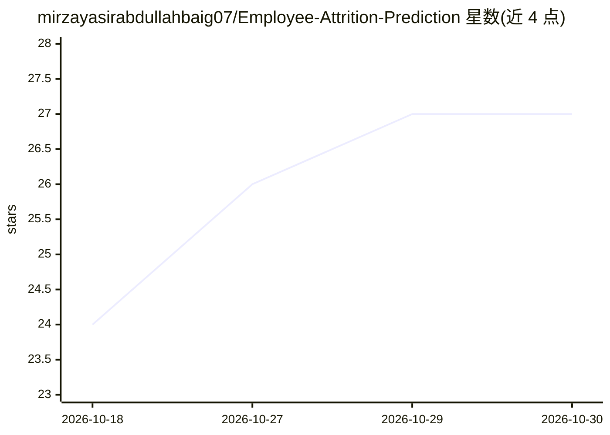

# mirzayasirabdullahbaig07/Employee-Attrition-Prediction

⭐ 27 · Python · 推送 2026-08-23 · [GitHub](https://github.com/mirzayasirabdullahbaig07/Employee-Attrition-Prediction) · [官网](https://employee-attrition-prediction07.streamlit.app/) · 个人维护

**员工流失预测端到端项目：Colab 训练 + Streamlit 部署**

包含训练到部署全流程的机器学习项目：在 Google Colab 笔记本中训练并调优 Random Forest 分类器（GridSearchCV 对比基线与调优模型），产出模型 pkl、StandardScaler、LabelEncoder 与列序文件；Streamlit 应用 app.py 提供单条与批量流失风险预测的自定义 UI，可本地 venv 运行后推送到 GitHub 并部署至 Streamlit Community Cloud 获得公开 URL。面向想完成可部署 ML 项目的开发者与学习者。

## 筛选速览

| 维度 | 判定 | 备注 |
|---|---|---|
| AI 角色 | `ai-native` | 本体是模型或模型工具 |
| 许可风险 | `none` | — |
| 部署形态 | `None` |  |
| 模型依赖 | — | README 未给出锁定关系 |
| 硬件要求 | — | 无带数字的原话,不猜 |
| 安装摩擦 | `low` | 无编译、无系统依赖或容器化 |
| 成熟度 | — | 结构信号不足 |

## 能力要点

- Random Forest 基线 + GridSearchCV 调优，在同一测试集上对比后选定最终模型
- Streamlit 应用支持单条与批量流失风险预测
- Colab 训练自动下载 5 个 pkl 工件（模型/缩放器/编码器/列序）
- 五步部署流程指引至 Streamlit Community Cloud

## 适用场景

- 训练并部署一个员工流失风险预测应用
- 学习从 Colab 训练到 Streamlit 云部署的完整流程
- 对员工数据做单条或批量的流失风险打分

## 场景标签

 · 领域:机器学习/人力资源分析

## 证据(README 行号)

> L3: Train in Google Colab → deploy a live "Retention Pulse" app on Streamlit
> L10: |`app.py`|Streamlit app — single & batch attrition risk predictions, full custom UI|✅ Yes|
> L13: |`attrition_model.pkl`|Trained, tuned Random Forest classifier|✅ Yes|

## 星数曲线

2026-10-18 24 → 2026-10-30 27（+3）

---
*卡片 v1 · prompt 1.4 · 生成 2026-10-27 · 置信度 high · 依据 README sha `51507f628ad5` · [字段定义](../../DATASET.md)*
