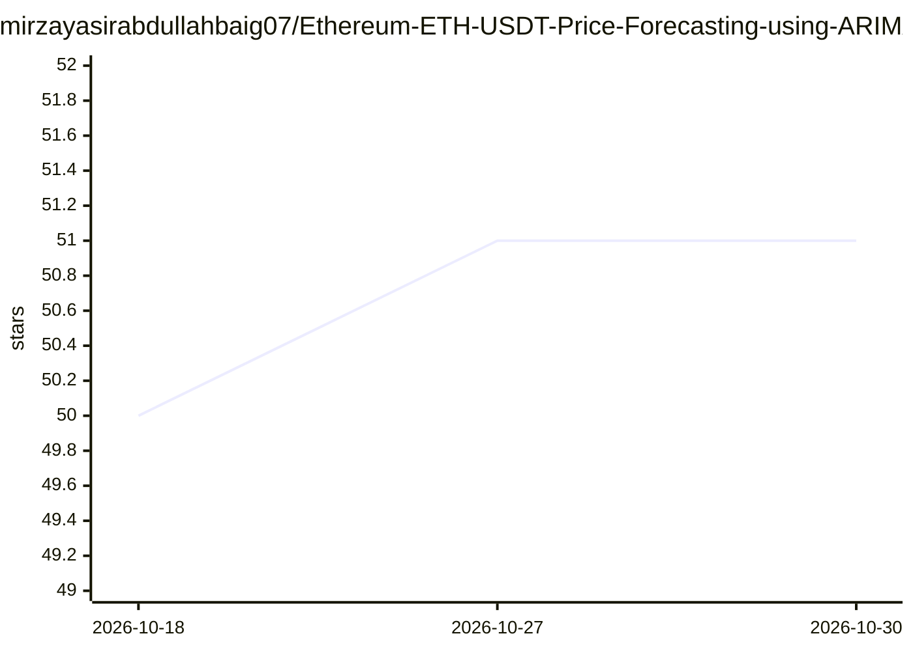

# mirzayasirabdullahbaig07/Ethereum-ETH-USDT-Price-Forecasting-using-ARIMA

⭐ 51 · Jupyter Notebook · 推送 2026-08-26 · [GitHub](https://github.com/mirzayasirabdullahbaig07/Ethereum-ETH-USDT-Price-Forecasting-using-ARIMA) · 个人维护

**用 ARIMA 模型预测以太坊（ETH/USDT）未来价格的时间序列分析项目**

基于 Kaggle 加密货币历史价格数据的分析项目：对 ETH/USDT 做预处理、EDA（移动平均、成交量趋势）、ADF 平稳性检验与差分、ACF/PACF 定阶，选定 ARIMA(2,1,1) 用 Statsmodels 建模，以 RMSE/MAPE/R² 评估并预测未来 30 天价格（含置信区间）与残差分析。面向学习时间序列分析与加密货币价格预测的用户，以 Python notebook/脚本形式提供，README 未给出安装或运行命令，也不构成投资建议声明。

## 筛选速览

| 维度 | 判定 | 备注 |
|---|---|---|
| AI 角色 | `ai-native` | 本体是模型或模型工具 |
| 许可风险 | `none` | — |
| 部署形态 | `None` |  |
| 模型依赖 | — | README 未给出锁定关系 |
| 硬件要求 | — | 无带数字的原话,不猜 |
| 安装摩擦 | `low` | 无编译、无系统依赖或容器化 |
| 成熟度 | — | 结构信号不足 |

## 能力要点

- ADF 平稳性检验与差分处理流程
- ACF/PACF 定阶，选定 ARIMA(2,1,1)
- 以 RMSE/MAPE/R² 评估，输出 30 天预测与置信区间

## 适用场景

- 学习 ARIMA 时间序列建模的完整流程
- 对加密货币价格数据做探索性分析与预测实验

## 场景标签

`数据分析` · 领域:效率与自动化

## 证据(README 行号)

> L9: - Apply ARIMA modeling for future price prediction.
> L45: - Built ARIMA model using Statsmodels.

## 星数曲线

2026-10-18 50 → 2026-10-30 51（+1）

---
*卡片 v1 · prompt 1.4 · 生成 2026-10-24 · 置信度 high · 依据 README sha `d7721a58774f` · [字段定义](../../DATASET.md)*
