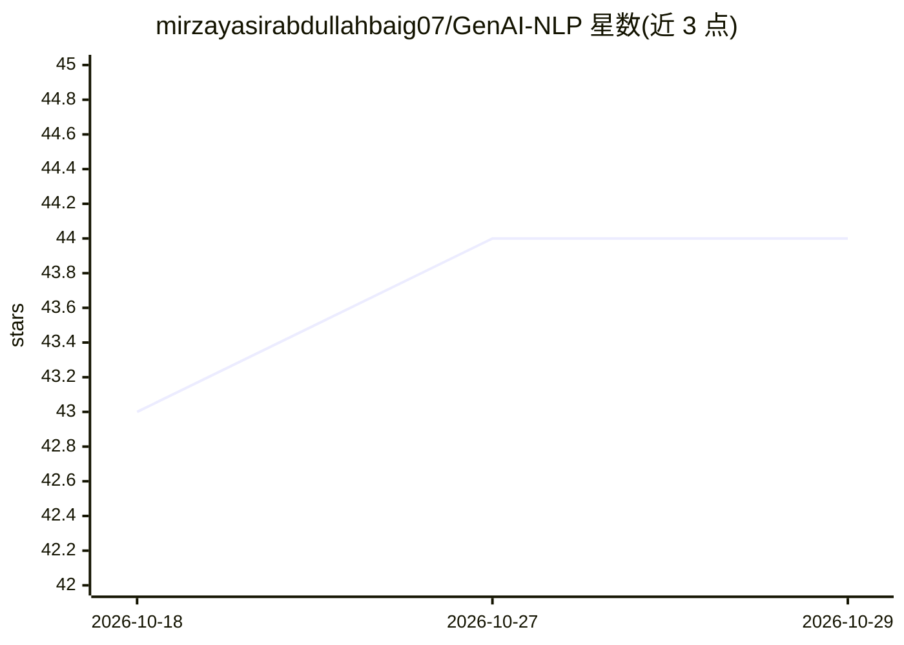

# mirzayasirabdullahbaig07/GenAI-NLP

⭐ 44 · Python · 推送 2026-03-16 · [GitHub](https://github.com/mirzayasirabdullahbaig07/GenAI-NLP) · 个人维护

**NLP 课程的结构化笔记与实现集合（含实战项目）**

基于一门完整自然语言处理（NLP）课程整理的学习仓库，内容从 NLP 概念、端到端流程、文本预处理、文本表示（BoW/TF-IDF/N-grams）、Word2Vec、文本分类、POS 标注（HMM/Viterbi）到实战项目（Quora 重复问题对识别）逐章组织，含部署环节（Heroku）。技术栈使用 Python、NumPy、Pandas、Scikit-learn、NLTK、Gensim、Flask、Heroku。仓库以笔记与代码实现为主，README 未给出安装命令或运行说明。

## 筛选速览

| 维度 | 判定 | 备注 |
|---|---|---|
| AI 角色 | `ai-knowledge` | 知识聚合/清单类 |
| 许可风险 | `none` | — |
| 部署形态 | `None` |  |
| 模型依赖 | — | README 未给出锁定关系 |
| 硬件要求 | — | 无带数字的原话,不猜 |
| 安装摩擦 | `low` | 无编译、无系统依赖或容器化 |
| 成熟度 | — | 结构信号不足 |

## 能力要点

- 覆盖 NLP 概念到部署的 8 个章节课程内容
- 含 Word2Vec（CBOW/Skip-gram）训练教程与 Game of Thrones 示例
- 含 Quora 重复问题对识别端到端项目并部署到 Heroku

## 适用场景

- 系统学习 NLP 从基础到部署的完整流程
- 参考文本预处理、文本表示与分类的代码实现
- 跟随端到端项目练习建模与部署

## 场景标签

`教程课程` · 领域:学习与行业

## 证据(README 行号)

> L3: This repository contains structured notes, implementations, and projects based on a complete **Natural Language Proc
> L65: ### 8️⃣ NLP Project – Duplicate Question Pairs

## 星数曲线

2026-10-18 43 → 2026-10-29 44（+1）

---
*卡片 v1 · prompt 1.4 · 生成 2026-10-25 · 置信度 high · 依据 README sha `72dfb00e6e81` · [字段定义](../../DATASET.md)*
