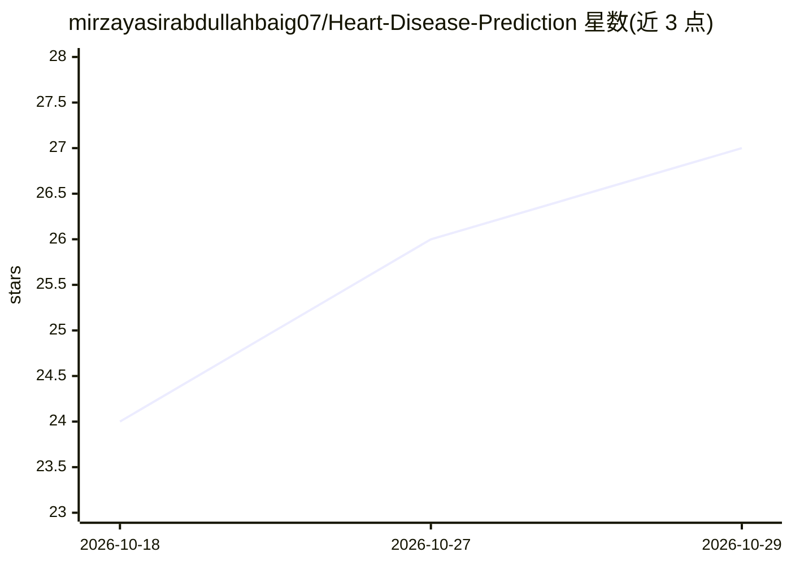

# mirzayasirabdullahbaig07/Heart-Disease-Prediction

⭐ 27 · Jupyter Notebook · 推送 2026-09-08 · [GitHub](https://github.com/mirzayasirabdullahbaig07/Heart-Disease-Prediction) · [官网](https://heart-disease-prediction07.streamlit.app/) · 个人维护

**基于 Random Forest 的心脏病风险预测 Streamlit 应用**

机器学习 Web 应用：输入年龄、胸痛类型、血压等 13 项临床特征，使用 scikit-learn 训练的 Random Forest 模型预测患者是否有心脏病风险。Notebook 中对比了 Logistic Regression、SVM、XGBoost 等 8 种算法，Random Forest 准确率约 90% 被选为最终部署模型。通过 Streamlit 本地运行或部署到 Streamlit Cloud，可在 Google Colab 中重新训练并替换模型文件。作者声明仅供教育用途，非认证医疗诊断工具。

## 筛选速览

| 维度 | 判定 | 备注 |
|---|---|---|
| AI 角色 | `ai-native` | 本体是模型或模型工具 |
| 许可风险 | `none` | — |
| 部署形态 | `library` | 以包/库形式分发 |
| 模型依赖 | — | README 未给出锁定关系 |
| 硬件要求 | — | 无带数字的原话,不猜 |
| 安装摩擦 | `low` | 无编译、无系统依赖或容器化 |
| 成熟度 | — | 结构信号不足 |

## 能力要点

- 基于 13 项临床特征输出心脏病风险预测
- 对比 8 种算法后选定 Random Forest（约 90% 准确率）
- 提供 Streamlit 本地运行与 Streamlit Cloud 部署步骤
- 支持在 Google Colab 中用新数据重新训练模型

## 适用场景

- 作为机器学习入门教学项目学习建模与部署流程
- 在网页中输入临床指标获取风险预测演示
- 替换数据集重新训练自有模型

## 场景标签

`教程课程` · 领域:学习与行业

## 证据(README 行号)

> L3: A machine learning web app that predicts whether a patient is at risk of heart disease, based on 13 clinical feature
> L25: |**Random Forest**|**~90%** ✅|

## 星数曲线

2026-10-18 24 → 2026-10-29 27（+3）

---
*卡片 v1 · prompt 1.4 · 生成 2026-10-27 · 置信度 high · 依据 README sha `f41bd2cf9c6e` · [字段定义](../../DATASET.md)*
