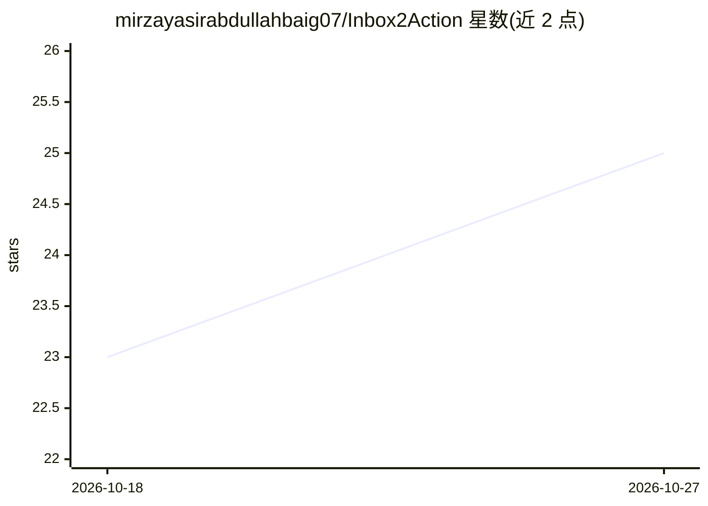

# mirzayasirabdullahbaig07/Inbox2Action

⭐ 25 · Python · 推送 2026-08-26 · [GitHub](https://github.com/mirzayasirabdullahbaig07/Inbox2Action) · [官网](https://inbox2action.streamlit.app/) · 组织维护

**面向企业的自主任务 Agent：将非结构化来件解析为执行计划与草拟回复**

All Things Agentic Hackathon Taskmaster Track 的参赛作品，部署在 Streamlit 上的企业任务代理：接收客户邮件、发票回执、bug 报告等非结构化输入，调用 Gemini 2.5 Flash（经 Google GenAI SDK）抽取优先级、类别、行动项与截止日期等实体，生成端到端执行计划并起草可直接发送的回复，通过 Plotly 仪表盘展示执行遥测。提供 Dockerfile 支持部署到 Google Cloud Run，API 密钥经 .env 动态加载。为团队参赛项目，功能以演示为主。

## 筛选速览

| 维度 | 判定 | 备注 |
|---|---|---|
| AI 角色 | `ai-native` | 本体是模型或模型工具 |
| 许可风险 | `permissive` | — |
| 部署形态 | `self-host` | docker 或自建部署 |
| 模型依赖 | — | README 未给出锁定关系 |
| 硬件要求 | — | 无带数字的原话,不猜 |
| 安装摩擦 | `low` | 无编译、无系统依赖或容器化 |
| 成熟度 | — | 结构信号不足 |

## 能力要点

- Gemini 2.5 Flash 抽取任务元数据（优先级/类别/截止日期/行动项）
- 自动生成执行计划并起草 Markdown 格式回复
- Plotly 交互式仪表盘展示运营指标与遥测
- Dockerfile 支持 Google Cloud Run 容器化部署

## 适用场景

- 把收件箱里的支持请求与 bug 报告自动转成带优先级的行动项
- 自动起草专业回复邮件减少人工整理时间
- 在仪表盘中查看任务接入量与执行遥测

## 场景标签

 · 领域:企业自动化/Agent 应用

## 证据(README 行号)

> L17: **Inbox2Action** is an autonomous, next-generation Taskmaster Agent operating inside an enterprise command center. 
> L89: * **Core AI Engine:** Google GenAI SDK (`google-genai`), Gemini 2.5 Flash (`gemini-2.5-flash`)

## 星数曲线

2026-10-18 23 → 2026-10-27 25（+2）

---
*卡片 v1 · prompt 1.4 · 生成 2026-10-27 · 置信度 high · 依据 README sha `2975b35a8847` · [字段定义](../../DATASET.md)*
