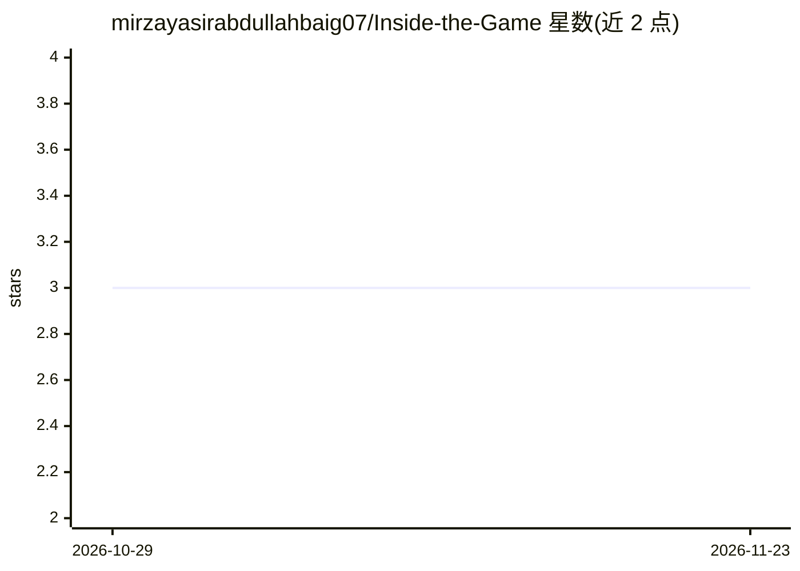

# mirzayasirabdullahbaig07/Inside-the-Game

⭐ 3 · Python · 推送 2026-10-26 · [GitHub](https://github.com/mirzayasirabdullahbaig07/Inside-the-Game) · [官网](https://inside-the-game.streamlit.app/) · 个人维护

**多 Agent 足球比赛解说与复盘生成应用，基于合成赛事数据**

为 Inside the Game 开发者黑客松构建的多 Agent 比赛智能应用：将比赛事件（传球、射门、红黄牌、角球）转化为可解释的关键时刻说明、三种语气的实时解说、经核验的全场复盘及动量统计视图。内部分为 Analyst、Narrator、Recap、Checker 四个 Agent，通过共享状态交接，被拒草稿可带回反馈重试（最多 2 次）；LLM 不可用时回退到确定性模板。数据由种子随机模型生成，不使用真实英超数据。以 Streamlit 应用形式运行。

## 筛选速览

| 维度 | 判定 | 备注 |
|---|---|---|
| AI 角色 | `ai-native` | 本体是模型或模型工具 |
| 许可风险 | `none` | — |
| 部署形态 | `library` | 以包/库形式分发 |
| 模型依赖 | locked-api |  |
| 硬件要求 | — | 无带数字的原话,不猜 |
| 安装摩擦 | `low` | 无编译、无系统依赖或容器化 |
| 成熟度 | — | 结构信号不足 |

## 能力要点

- 四个 Agent（统计/解说/复盘/核验）协作流水线，含拒稿反馈重试机制
- LLM 不可用时以确定性模板兜底，结果始终经核验
- 合成赛事数据，种子随机生成保证可复现
- 可选接入 Azure OpenAI，无密钥也可离线运行

## 适用场景

- 生成足球比赛的可解释关键时刻与实时解说
- 为分析师提供动量与统计视图
- 自动产出经事实核验的全场复盘报道

## 场景标签

`多智能体` · 领域:Agent 开发

## 证据(README 行号)

> L13: ## Agents
> L27: - **Azure OpenAI via Microsoft Foundry** for commentary and recaps (optional; app runs offline without it)

## 星数曲线

2026-10-29 3 → 2026-11-23 3（+0）

---
*卡片 v1 · prompt 1.4 · 生成 2026-11-21 · 置信度 high · 依据 README sha `90d8a0aab4a7` · [字段定义](../../DATASET.md)*
