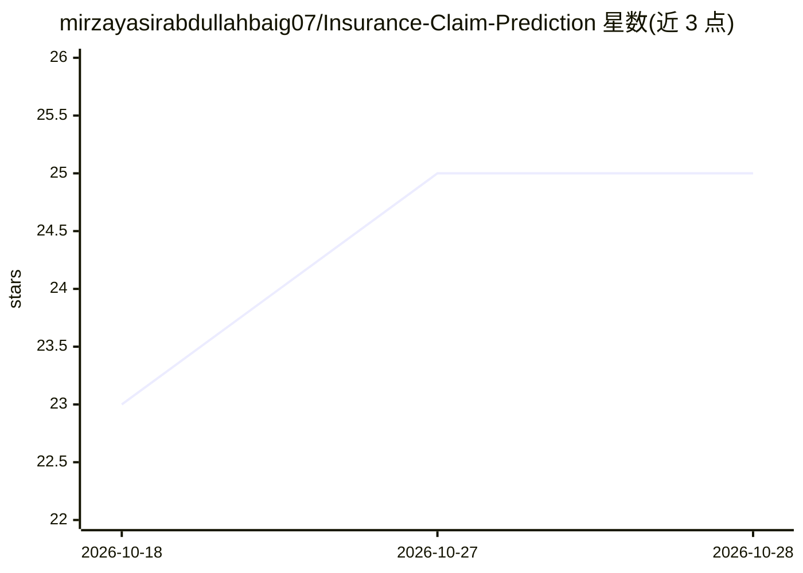

# mirzayasirabdullahbaig07/Insurance-Claim-Prediction

⭐ 26 · Python · 推送 2026-08-23 · [GitHub](https://github.com/mirzayasirabdullahbaig07/Insurance-Claim-Prediction) · [官网](https://insurance-claim-prediction07.streamlit.app/) · 个人维护

**保险理赔金额回归预测项目，含 Streamlit 部署流程**

端到端的保险理赔金额预测项目：在 Google Colab 中用 insurance.csv 训练回归模型，notebook 对比 Linear Regression、Random Forest 与 Gradient Boosting 并用 GridSearchCV 调优，最终保存调优后的 Random Forest 回归器及配套 LabelEncoder/特征列 pkl 文件。随后以 app.py 构建 Streamlit 应用，支持单笔与批量理赔金额估算，并提供本地测试（venv + requirements.txt）与推送 GitHub 后部署到 Streamlit Community Cloud 的完整步骤。

## 筛选速览

| 维度 | 判定 | 备注 |
|---|---|---|
| AI 角色 | `ai-native` | 本体是模型或模型工具 |
| 许可风险 | `none` | — |
| 部署形态 | `None` |  |
| 模型依赖 | — | README 未给出锁定关系 |
| 硬件要求 | — | 无带数字的原话,不猜 |
| 安装摩擦 | `low` | 无编译、无系统依赖或容器化 |
| 成熟度 | — | 结构信号不足 |

## 能力要点

- 对比三种回归模型并以 GridSearchCV 调优，预测连续理赔金额
- Streamlit 应用支持单笔与批量理赔估算
- 提供从 Colab 训练到 Streamlit Community Cloud 部署的完整流程

## 适用场景

- 学习机器学习回归项目的端到端训练与部署
- 演示保险理赔金额预测的在线应用
- 作为 Streamlit 云部署的教学模板

## 场景标签

`数据分析` · 领域:效率与自动化

## 证据(README 行号)

> L4: Community Cloud. This predicts a **continuous claim amount** (regression),
> L77: so this is trained as a **regression** problem — the notebook compares

## 星数曲线

2026-10-18 23 → 2026-10-28 25（+2）

---
*卡片 v1 · prompt 1.4 · 生成 2026-10-27 · 置信度 high · 依据 README sha `556bf5b99bfa` · [字段定义](../../DATASET.md)*
