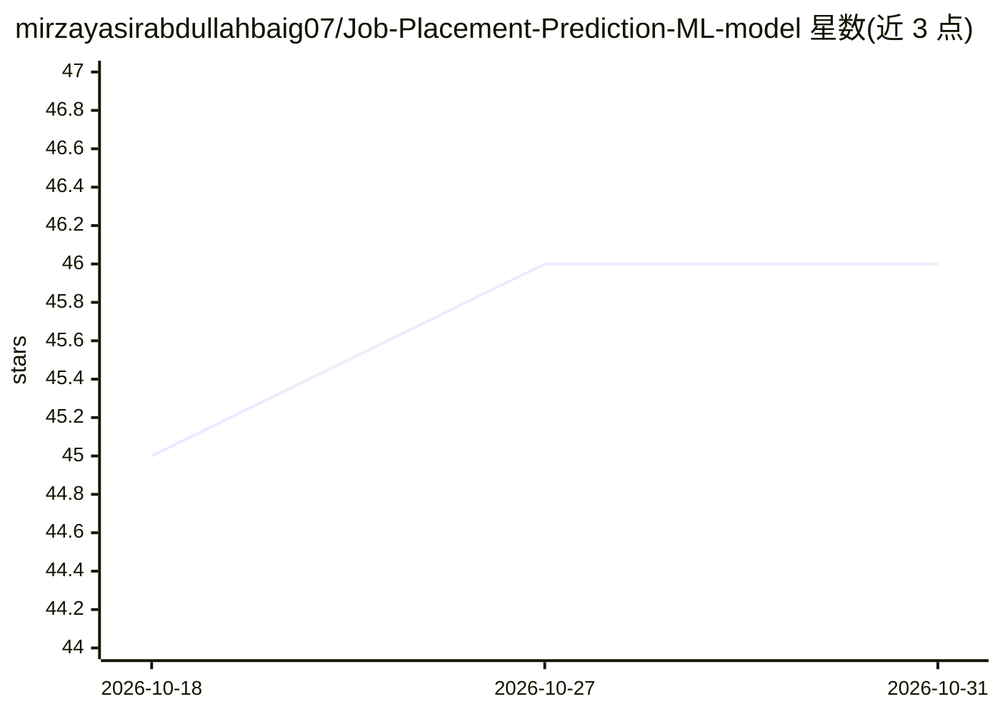

# mirzayasirabdullahbaig07/Job-Placement-Prediction-ML-model

⭐ 46 · Jupyter Notebook · 推送 2025-11-26 · [GitHub](https://github.com/mirzayasirabdullahbaig07/Job-Placement-Prediction-ML-model) · [官网](https://job-placement-prediction-ml-model-007.streamlit.app/) · 个人维护

**Streamlit Web 应用：预测求职者能否被录用**

基于 Streamlit 构建的交互式 Web 应用 AdmitWise：用户输入 SSC/HSC/学位/MBA 成绩、工作经验、专业方向等特征，经独热编码后由 Pickle 加载的离线训练 Logistic Regression 模型输出 'Placed' 或 'Not Placed' 的二分类预测及概率。面向学生、HR 团队与学业顾问，使用 Scikit-learn/Pandas/NumPy 构建，Python 3.9+ 运行。README 声明仅用于教育目的，未经验证不得用于真实商业决策；安装方式为克隆仓库运行。

## 筛选速览

| 维度 | 判定 | 备注 |
|---|---|---|
| AI 角色 | `ai-native` | 本体是模型或模型工具 |
| 许可风险 | `none` | — |
| 部署形态 | `None` |  |
| 模型依赖 | — | README 未给出锁定关系 |
| 硬件要求 | — | 无带数字的原话,不猜 |
| 安装摩擦 | `low` | 无编译、无系统依赖或容器化 |
| 成熟度 | — | 结构信号不足 |

## 能力要点

- 基于学业成绩等特征输出录用/未录用的二分类预测与概率
- Logistic Regression 模型离线训练，Pickle 加载
- Streamlit 表单界面，输入框与下拉菜单供非技术用户使用
- 支持用新数据重训模型或扩展特征

## 适用场景

- 学生输入成绩与背景，查看被录用概率
- HR 团队或学业顾问获取数据驱动的录用预测参考
- 教学演示 Logistic Regression 分类流程

## 场景标签

 · 领域:机器学习/人力资源预测

## 证据(README 行号)

> L3: An **AI-powered interactive web application** built with **Streamlit** that predicts whether a candidate will get pl
> L32: 3. A **Logistic Regression model** (trained offline) is loaded using Pickle.
> L33: 4. The model outputs a **binary prediction**: “Placed” or “Not Placed”.

## 星数曲线

2026-10-18 45 → 2026-10-31 46（+1）

---
*卡片 v1 · prompt 1.4 · 生成 2026-10-25 · 置信度 high · 依据 README sha `465c3b11d65d` · [字段定义](../../DATASET.md)*
