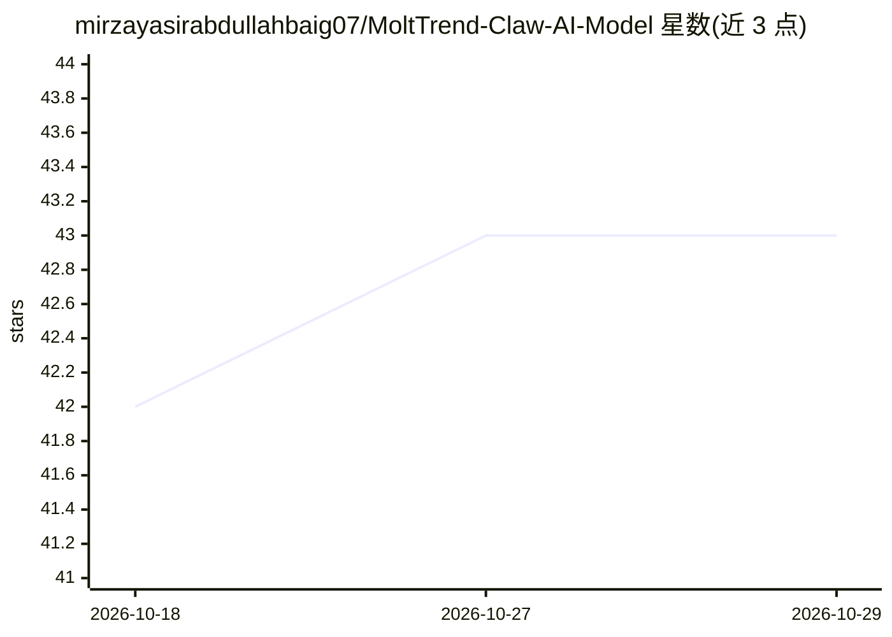

# mirzayasirabdullahbaig07/MoltTrend-Claw-AI-Model

⭐ 43 · Python · 推送 2026-04-15 · [GitHub](https://github.com/mirzayasirabdullahbaig07/MoltTrend-Claw-AI-Model) · [官网](https://molttrend-claw-ai-model.streamlit.app/) · 个人维护

**自主加密货币趋势监测 AI agent，生成分析报告**

为 SURGE × OpenClaw 黑客松构建的自主 AI agent：通过 CoinGecko API 监测实时加密货币趋势，使用 Gemini AI 推理检测市场叙事与情绪，将趋势历史以 JSON 持久化存储形成长期记忆，并生成用于决策的自主报告。基于 OpenClaw 本地优先 agent 运行时，提供 Streamlit 多页界面（实时仪表盘、趋势分析图表、历史报告）。安装方式为克隆仓库源码运行，README 中截图部分为占位符，配置细节未在可见范围内展示完整。

## 筛选速览

| 维度 | 判定 | 备注 |
|---|---|---|
| AI 角色 | `ai-native` | 本体是模型或模型工具 |
| 许可风险 | `none` | — |
| 部署形态 | `None` |  |
| 模型依赖 | — | README 未给出锁定关系 |
| 硬件要求 | — | 无带数字的原话,不猜 |
| 安装摩擦 | `low` | 无编译、无系统依赖或容器化 |
| 成熟度 | — | 结构信号不足 |

## 能力要点

- CoinGecko API 监测实时加密货币趋势
- Gemini AI 生成市场情绪、叙事与短期预测
- JSON 持久化存储趋势历史形成长期记忆
- Streamlit 多页仪表盘（实时趋势/分析图表/历史报告）

## 适用场景

- 持续跟踪加密货币热点与市场叙事变化
- 查看基于历史记忆的趋势演化分析报告
- 辅助加密货币相关决策的信息整理

## 场景标签

`数据分析` · 领域:效率与自动化

## 证据(README 行号)

> L5: MoltTrend Claw is a privacy-first, autonomous AI agent that monitors cryptocurrency trends, analyzes market narrativ
> L12: - Using AI reasoning to detect market narratives

## 星数曲线

2026-10-18 42 → 2026-10-29 43（+1）

---
*卡片 v1 · prompt 1.4 · 生成 2026-10-25 · 置信度 high · 依据 README sha `f47657785483` · [字段定义](../../DATASET.md)*
