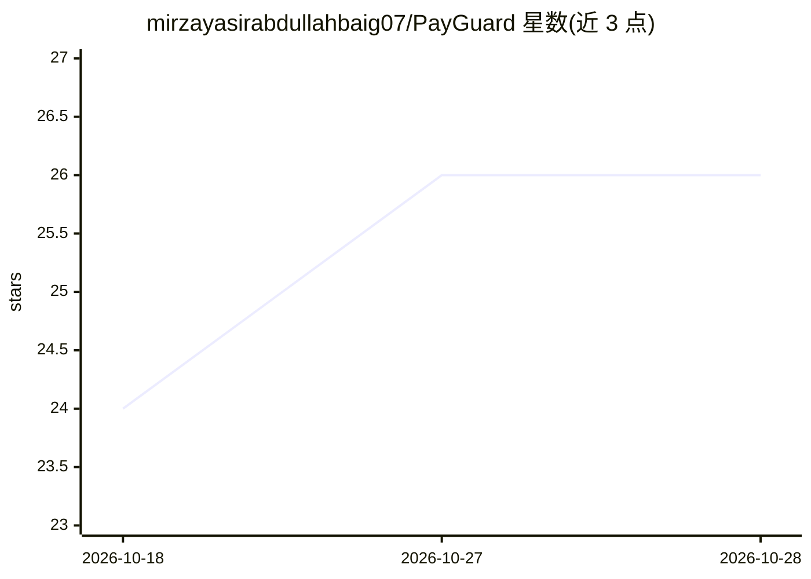

# mirzayasirabdullahbaig07/PayGuard

⭐ 27 · TypeScript · 推送 2026-08-09 · [GitHub](https://github.com/mirzayasirabdullahbaig07/PayGuard) · [官网](https://payguard07.netlify.app/) · 个人维护

**给自由职业者的客户风险评估工具：输入信息出风险等级与防护邮件**

面向自由职业者与小团队的客户背调工具：用户输入关于潜在客户的已知信息（付款历史、沟通风格、他人警告等），经 Supabase Edge Function 调用 Groq 上的 Llama 3.3 70B 模型分析，从文本中提取具体风险信号，给出 Low/Medium/High/信息不足的风险等级与 2–4 条建议；风险为中高时自动起草要求定金、里程碑付款或托管条款的防护邮件。全程无登录、不存数据，有状态仅限单次会话。UI 由 native.builder 平台生成，React + TypeScript + Tailwind 实现。

## 筛选速览

| 维度 | 判定 | 备注 |
|---|---|---|
| AI 角色 | `ai-native` | 本体是模型或模型工具 |
| 许可风险 | `none` | — |
| 部署形态 | `library` | 以包/库形式分发 |
| 模型依赖 | locked-api |  |
| 硬件要求 | — | 无带数字的原话,不猜 |
| 安装摩擦 | `low` | 无编译、无系统依赖或容器化 |
| 成熟度 | — | 结构信号不足 |

## 能力要点

- 从输入文本提取具体风险信号并给出四级风险评级
- 中高风险时自动起草要求定金/里程碑/托管的防护邮件
- 无登录、无数据存储的完全无状态会话
- API 密钥保留在 Supabase Edge Function 服务端

## 适用场景

- 接单前快速核查新客户的付款信誉与风险
- 风险较高时获得一封可用的付款条款谈判邮件草稿
- 整理零散的客户信息形成结构化评估

## 场景标签

`AI 助手` `AI 写作` · 领域:对话与助手

## 证据(README 行号)

> L20: 2. A Supabase Edge Function sends this to an AI model (via **Groq**), which:
> L30: - **Groq** — fast LLM inference for the risk-analysis step (`llama-3.3-70b-versatile`)

## 星数曲线

2026-10-18 24 → 2026-10-28 26（+2）

---
*卡片 v1 · prompt 1.4 · 生成 2026-10-27 · 置信度 high · 依据 README sha `b5ef02d39cf7` · [字段定义](../../DATASET.md)*
