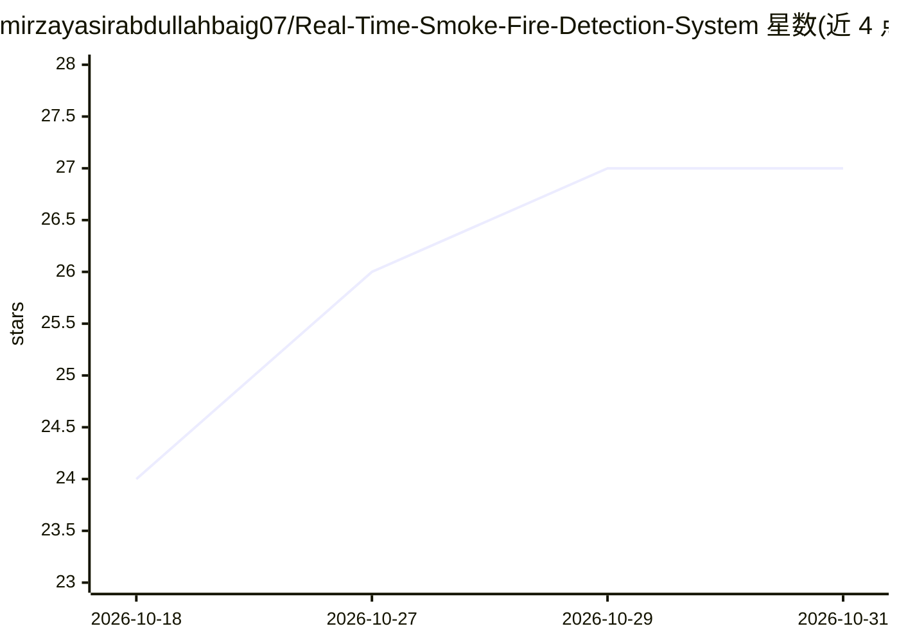

# mirzayasirabdullahbaig07/Real-Time-Smoke-Fire-Detection-System

⭐ 27 · Jupyter Notebook · 推送 2026-09-13 · [GitHub](https://github.com/mirzayasirabdullahbaig07/Real-Time-Smoke-Fire-Detection-System) · [官网](https://real-time-smoke-fire-detection-system.streamlit.app/) · 个人维护

**基于 YOLO11 的火烟实时检测系统，支持图片/视频/摄像头**

端到端计算机视觉应用：使用自定义训练的 YOLO11 权重对图片、视频（逐帧处理）和实时摄像头流检测火焰与烟雾，输出标注边界框与置信度。附加功能包括 CLAHE 低光照增强预处理、推理分辨率/跳帧/置信度阈值等性能调节项、浏览器可播放的 H.264 MP4 输出，以及检测触发时经 Gmail SMTP 发送带截图的邮件告警（60 秒冷却）。以 Streamlit 网页应用形式提供，从源码安装运行，声明仅用于教育与科研目的。

## 筛选速览

| 维度 | 判定 | 备注 |
|---|---|---|
| AI 角色 | `ai-native` | 本体是模型或模型工具 |
| 许可风险 | `none` | — |
| 部署形态 | `library` | 以包/库形式分发 |
| 模型依赖 | — | README 未给出锁定关系 |
| 硬件要求 | — | 无带数字的原话,不猜 |
| 安装摩擦 | `medium` | 含编译或系统依赖之一 |
| 成熟度 | — | 结构信号不足 |

## 能力要点

- 图片/视频/实时摄像头三种输入源的 YOLO11 火烟检测
- CLAHE 低光照图像增强预处理
- 检测触发 Gmail SMTP 邮件告警（附检测截图，60 秒冷却）
- 推理分辨率、跳帧、置信度阈值等实时性能调节

## 适用场景

- 上传图片或视频检查其中是否有火焰与烟雾
- 用摄像头做实时火烟监控并接收邮件告警
- 低光照环境下增强图像后再做检测

## 场景标签

`目标检测` · 领域:感知与多模态

## 证据(README 行号)

> L5: This end-to-end Computer Vision application uses custom-trained YOLO11 weights to detect **fire** and **smoke** acro
> L132: |**Model**|YOLO11 / Ultralytics|Fire and smoke object detection|

## 星数曲线

2026-10-18 24 → 2026-10-31 27（+3）

---
*卡片 v1 · prompt 1.4 · 生成 2026-10-27 · 置信度 mid · 依据 README sha `31b01a4e0f25` · [字段定义](../../DATASET.md)*
