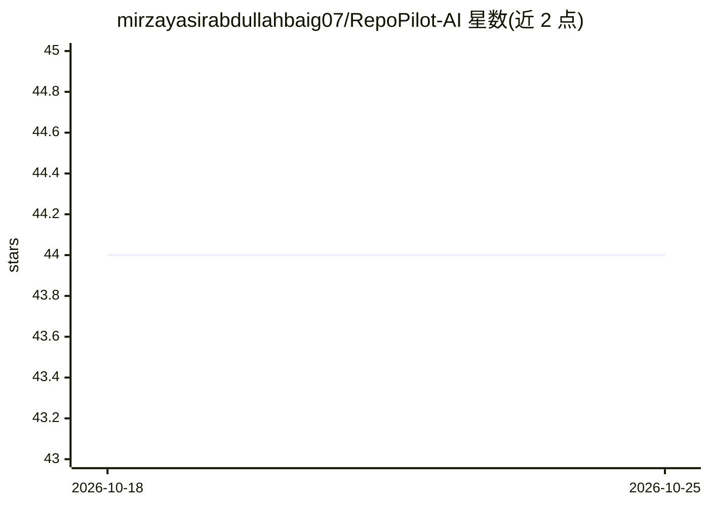

# mirzayasirabdullahbaig07/RepoPilot-AI

⭐ 44 · HTML · 推送 2026-05-17 · [GitHub](https://github.com/mirzayasirabdullahbaig07/RepoPilot-AI) · [官网](https://repopilot07.netlify.app/) · 个人维护

**单文件网页应用：AI 分析 GitHub 仓库架构与代码问答**

为 IBM Bob Hackathon 2026 构建的单页 Web 应用，纯 HTML/CSS/JavaScript 实现、无需构建工具。用户输入公开 GitHub 仓库 URL，通过 GitHub REST API 拉取仓库信息，调用 Groq API（llama-3.3-70b-versatile）生成架构可视化、技术栈检测、新开发者上手指南，并提供针对代码库的对话问答标签页；生成的引导文档可导出为 ONBOARDING.md。运行仅需浏览器与免费 Groq API key，密钥可写入文件或存于 localStorage。

## 筛选速览

| 维度 | 判定 | 备注 |
|---|---|---|
| AI 角色 | `ai-native` | 本体是模型或模型工具 |
| 许可风险 | `permissive` | — |
| 部署形态 | `None` |  |
| 模型依赖 | locked-api |  |
| 硬件要求 | — | 无带数字的原话,不猜 |
| 安装摩擦 | `low` | 无编译、无系统依赖或容器化 |
| 成熟度 | — | 结构信号不足 |

## 能力要点

- 分析任意公开 GitHub 仓库的架构、技术栈与代码结构
- 基于 Groq LLM 的代码库问答（Ask Codebase 标签页）
- 自动生成并导出开发者上手文档 ONBOARDING.md
- 纯静态单文件实现，100% 客户端运行，无需构建工具

## 适用场景

- 接手陌生开源仓库时快速了解架构与技术栈
- 新成员入职时生成项目上手指南
- 对代码库提问获取 AI 回答

## 场景标签

`文档问答` `AI 写作` · 领域:内容生成

## 证据(README 行号)

> L5: RepoPilot AI is a single-page web application that uses AI to analyze GitHub repositories and provide instant insigh
> L16: - 💬 **AI-Powered Chat** - Ask questions about the codebase using Groq LLM

## 星数曲线

2026-10-18 44 → 2026-10-25 44（+0）

---
*卡片 v1 · prompt 1.4 · 生成 2026-10-25 · 置信度 high · 依据 README sha `201a9fd39651` · [字段定义](../../DATASET.md)*
