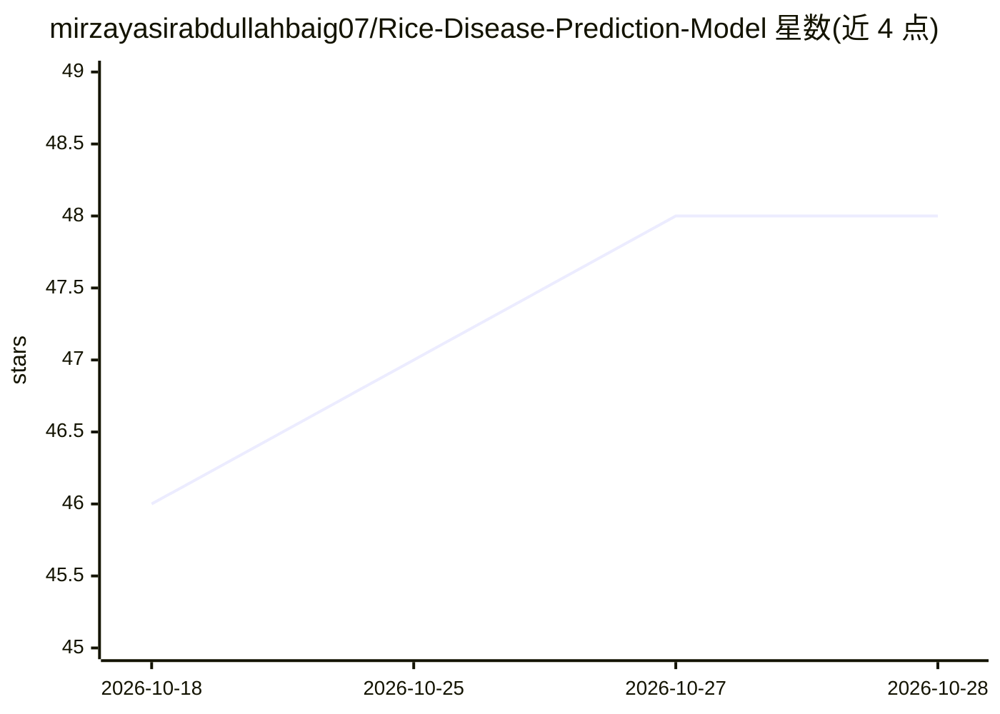

# mirzayasirabdullahbaig07/Rice-Disease-Prediction-Model

⭐ 48 · Python · 推送 2025-11-25 · [GitHub](https://github.com/mirzayasirabdullahbaig07/Rice-Disease-Prediction-Model) · [官网](https://rice-disease-prediction-model-007.streamlit.app/) · 个人维护

**基于 CNN 的水稻叶片病害图像识别 Streamlit 应用**

使用卷积神经网络（CNN）在公开水稻叶片图像数据集上训练的分类模型，通过 Streamlit 网页界面上传叶片图片，输出病害类别（Bacterial Leaf Blight、Brown Spot、Leaf Smut）及置信度。技术栈为 Python 3.9+、TensorFlow/Keras，模型以 Pickle/JSON 保存加载，代码模块化便于更新模型。README 声明仅用于教育目的，数据集限三类病害；通过克隆仓库源码运行。

## 筛选速览

| 维度 | 判定 | 备注 |
|---|---|---|
| AI 角色 | `ai-native` | 本体是模型或模型工具 |
| 许可风险 | `none` | — |
| 部署形态 | `None` |  |
| 模型依赖 | — | README 未给出锁定关系 |
| 硬件要求 | — | 无带数字的原话,不猜 |
| 安装摩擦 | `low` | 无编译、无系统依赖或容器化 |
| 成熟度 | — | 结构信号不足 |

## 能力要点

- CNN 模型对上传叶片图片输出病害类别与置信度
- 覆盖 3 类水稻叶片病害分类
- Streamlit 网页界面，含文件上传与预测流程
- 模块化 Python 代码，支持模型更新

## 适用场景

- 上传水稻叶片照片查看可能病害类别
- 了解 CNN 图像分类的教育演示
- 在其基础上替换数据集训练自己的病害模型

## 场景标签

`目标检测` · 领域:感知与多模态

## 证据(README 行号)

> L3: An **AI-powered interactive web application** built with **Streamlit** that predicts rice leaf diseases from images.
> L13: - Detects **rice leaf diseases** instantly.

## 星数曲线

2026-10-18 46 → 2026-10-28 48（+2）

---
*卡片 v1 · prompt 1.4 · 生成 2026-10-25 · 置信度 high · 依据 README sha `965806f5caaf` · [字段定义](../../DATASET.md)*
