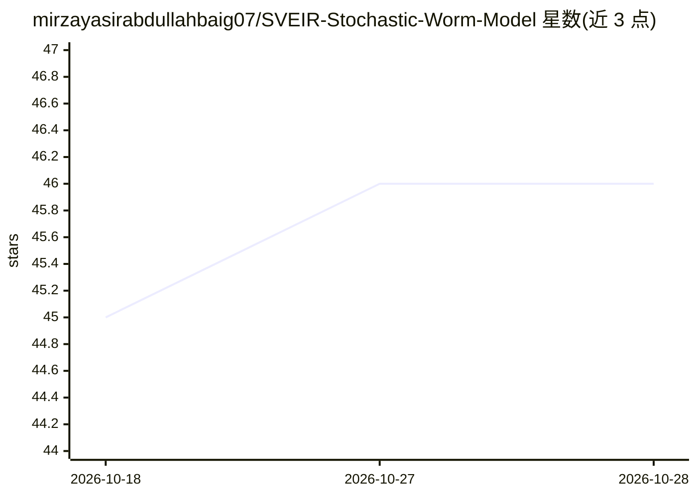

# mirzayasirabdullahbaig07/SVEIR-Stochastic-Worm-Model

⭐ 46 · Python · 推送 2025-12-11 · [GitHub](https://github.com/mirzayasirabdullahbaig07/SVEIR-Stochastic-Worm-Model) · [官网](https://sveir-stochastic-worm-model.streamlit.app/) · 个人维护

**随机 SVEIR 蠕虫传播模型：模拟无线网络中蠕虫扩散与灭绝条件**

实现随机 SVEIR 仓室模型（易感/接种/暴露/感染/康复），用随机微分方程模拟计算机蠕虫在 WSN、MANET、IoT 等无线网络中的传播，并通过构造 Lyapunov 函数分析感染持续或灭绝的条件。提供数值模拟与基于 Streamlit 的交互式界面，支持参数化实验。面向网络安全与传播动力学方向的研究人员，README 中虽带机器学习主题标签，但可见内容未描述 AI/ML 方法的使用。

## 筛选速览

| 维度 | 判定 | 备注 |
|---|---|---|
| AI 角色 | `ai-native` | 本体是模型或模型工具 |
| 许可风险 | `none` | — |
| 部署形态 | `None` |  |
| 模型依赖 | — | README 未给出锁定关系 |
| 硬件要求 | — | 无带数字的原话,不猜 |
| 安装摩擦 | `low` | 无编译、无系统依赖或容器化 |
| 成熟度 | — | 结构信号不足 |

## 能力要点

- 随机微分方程（SDE）建模蠕虫传播
- Lyapunov 函数分析蠕虫灭绝条件
- Streamlit 交互式界面与参数化实验

## 适用场景

- 研究无线网络中蠕虫的传播动态
- 评估补丁接种与恢复策略对感染灭绝的影响
- IoT/WSN 恶意软件传播的数值实验

## 场景标签

 · 领域:网络安全/传播动力学建模

## 证据(README 行号)

> L3: This repository implements a stochastic **SVEIR** model to study the spread of computer worms in wireless networks s
> L47: - Stochastic SVEIR model

## 星数曲线

2026-10-18 45 → 2026-10-28 46（+1）

---
*卡片 v1 · prompt 1.4 · 生成 2026-10-25 · 置信度 mid · 依据 README sha `7443ae3f60b6` · [字段定义](../../DATASET.md)*
