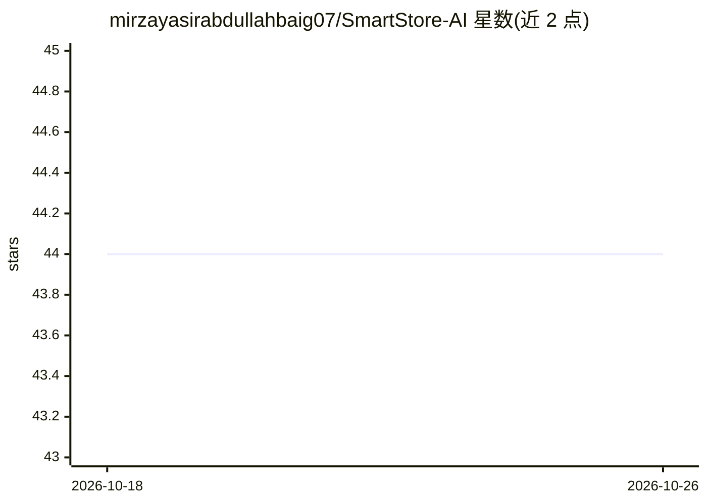

# mirzayasirabdullahbaig07/SmartStore-AI

⭐ 44 · Python · 推送 2026-02-13 · [GitHub](https://github.com/mirzayasirabdullahbaig07/SmartStore-AI) · [官网](https://smartstore-ai.streamlit.app) · 个人维护

**零售货架缺货监测与机器人补货模拟的 Streamlit 应用**

面向智能零售场景的仿真系统：持续监测货架状态（Full/Empty），跟踪客流量级别（High/Medium/Low）与货架空置时长，由基于规则的 AI 决策逻辑综合流量优先级与空置时长生成补货任务，模拟机器人 Dock→Shelf→Restock→Return 的补货动作，并在 Streamlit 仪表盘上实时展示货架状态、指标与操作日志。提供在线 Streamlit 演示与视频演示。注意这是模拟系统，不接入真实摄像头或传感器，AI 部分为决策逻辑而非模型推理。

## 筛选速览

| 维度 | 判定 | 备注 |
|---|---|---|
| AI 角色 | `ai-native` | 本体是模型或模型工具 |
| 许可风险 | `none` | — |
| 部署形态 | `None` |  |
| 模型依赖 | — | README 未给出锁定关系 |
| 硬件要求 | — | 无带数字的原话,不猜 |
| 安装摩擦 | `low` | 无编译、无系统依赖或容器化 |
| 成熟度 | — | 结构信号不足 |

## 能力要点

- 实时货架状态与客流量级别监测（模拟数据）
- 综合流量优先级与空置时长的 AI 决策逻辑生成补货任务
- 机器人补货动作仿真（Dock→Shelf→Restock→Return）
- Streamlit 实时仪表盘含指标、机器人位置与操作日志

## 适用场景

- 演示智能零售缺货检测与自动补货的运作流程
- 作为零售自动化课程的演示或原型
- 观察不同流量与空置时长下补货优先级的变化

## 场景标签

 · 领域:智能零售/仿真

## 证据(README 行号)

> L3: SmartStore AI is an AI-powered retail shelf monitoring and automated restocking simulation system.
> L25: - Detects empty shelves in real time
> L36: - 🤖 Automated robot restocking simulation
> L84: - AI-based decision logic

## 星数曲线

2026-10-18 44 → 2026-10-26 44（+0）

---
*卡片 v1 · prompt 1.4 · 生成 2026-10-25 · 置信度 high · 依据 README sha `5346220a5f91` · [字段定义](../../DATASET.md)*
