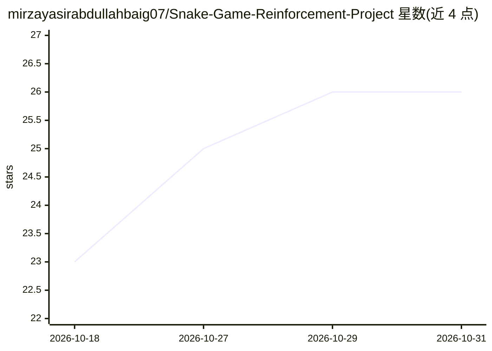

# mirzayasirabdullahbaig07/Snake-Game-Reinforcement-Project

⭐ 26 · Python · 推送 2026-09-25 · [GitHub](https://github.com/mirzayasirabdullahbaig07/Snake-Game-Reinforcement-Project) · 个人维护

**用 DQN 从零自学贪吃蛇的强化学习演示项目**

基于 PyTorch 与 Pygame 的强化学习演示：智能体通过 Deep Q-Learning（DQN）仅凭 +10/−10 奖励与方向性奖励塑形，从随机试错中自学贪吃蛇策略，无需手写规则。实现包含 11 输入 3 输出的 Q 网络、最多 10 万条经验回放、Epsilon-Greedy 探索，训练过程有实时得分曲线，破纪录时自动保存模型。纯 CPU 运行，无需 GPU/CUDA，pip 安装依赖后运行 agent.py 即开始训练。限制：前 50–80 局得分接近零属预期现象。

## 筛选速览

| 维度 | 判定 | 备注 |
|---|---|---|
| AI 角色 | `ai-native` | 本体是模型或模型工具 |
| 许可风险 | `none` | — |
| 部署形态 | `library` | 以包/库形式分发 |
| 模型依赖 | — | README 未给出锁定关系 |
| 硬件要求 | — | 无带数字的原话,不猜 |
| 安装摩擦 | `medium` | 含编译或系统依赖之一 |
| 成熟度 | — | 结构信号不足 |

## 能力要点

- 11 输入/3 输出的 Q 网络与经验回放（最多 100,000 条）
- Epsilon-Greedy 探索与奖励塑形（朝向食物的 +/- 微调）
- matplotlib 实时得分曲线，破纪录自动保存模型
- 纯 CPU 运行，无需 GPU/CUDA

## 适用场景

- 观察 DQN 智能体从随机试错到学会贪吃蛇的完整训练过程
- 学习/教学强化学习核心概念（Bellman 方程、经验回放、探索利用）
- 调整网络大小、学习率、探索率等参数做实验

## 场景标签

`强化学习` `教程课程` · 领域:学习与行业

## 证据(README 行号)

> L15: This project is a hands-on demonstration of **Reinforcement Learning**, specifically **Deep Q-Learning (DQN)**, app
> L19: - 🧠 **Deep Q-Network** — an 11-input, 3-output neural net approximating Q-values for every possible move

## 星数曲线

2026-10-18 23 → 2026-10-31 26（+3）

---
*卡片 v1 · prompt 1.4 · 生成 2026-10-27 · 置信度 high · 依据 README sha `82526d139c0c` · [字段定义](../../DATASET.md)*
