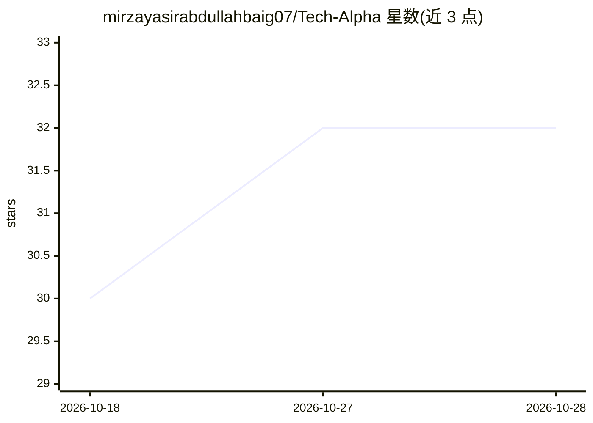

# mirzayasirabdullahbaig07/Tech-Alpha

⭐ 32 · TypeScript · 推送 2026-07-14 · [GitHub](https://github.com/mirzayasirabdullahbaig07/Tech-Alpha) · [官网](https://techalpha07.netlify.app/) · 个人维护

**AI 创业品牌 Tech Alpha 的展示型落地页网站**

面向创始人及 AI 业务品牌的单页落地页项目，用于展示服务、项目、作品集、创始人介绍与联系方式，采用黑金视觉设计。技术栈为 TanStack Start、React、Vite、Tailwind CSS、Radix UI 与 Framer Motion，响应式适配桌面与移动端。AI 仅作为品牌与内容主题，站点本身不含 AI 功能模块；需 Node.js 20+ 环境通过 npm/pnpm 本地运行或构建。

## 筛选速览

| 维度 | 判定 | 备注 |
|---|---|---|
| AI 角色 | `ai-enhanced` | 去掉 AI 部分产品仍成立 |
| 许可风险 | `none` | — |
| 部署形态 | `library` | 以包/库形式分发 |
| 模型依赖 | — | README 未给出锁定关系 |
| 硬件要求 | — | 无带数字的原话,不猜 |
| 安装摩擦 | `low` | 无编译、无系统依赖或容器化 |
| 成熟度 | — | 结构信号不足 |

## 能力要点

- 黑金视觉风格的单页落地页，含创始人/服务/作品集/项目/FAQ/联系区块
- 基于 TanStack Start + React + Vite + Tailwind CSS 构建
- 响应式适配桌面与移动端
- 提供 Netlify 在线演示与本地 dev/build/preview 脚本

## 适用场景

- AI 创业品牌或创始人搭建品牌展示与获客落地页
- 作为 TanStack Start 落地页项目的参考实现

## 场景标签

 · 领域:Web 前端/品牌展示

## 证据(README 行号)

> L1: # Tech Alpha | AI Startup Landing Page
> L3: A refined, premium landing page for Tech Alpha, a modern AI startup brand built to showcase services, projects, port
> L18: - AI strategy and product thinking

## 星数曲线

2026-10-18 30 → 2026-10-28 32（+2）

---
*卡片 v1 · prompt 1.4 · 生成 2026-10-26 · 置信度 mid · 依据 README sha `f625fa193fdf` · [字段定义](../../DATASET.md)*
