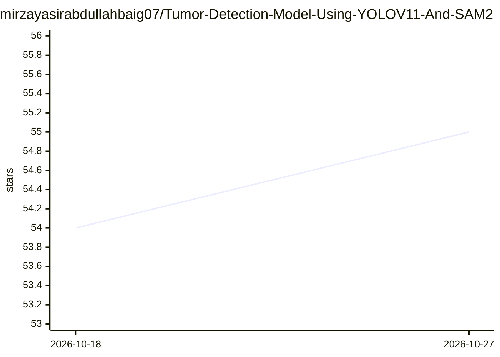

# mirzayasirabdullahbaig07/Tumor-Detection-Model-Using-YOLOV11-And-SAM2

⭐ 55 · Python · 推送 2026-02-26 · [GitHub](https://github.com/mirzayasirabdullahbaig07/Tumor-Detection-Model-Using-YOLOV11-And-SAM2) · 个人维护

**用 YOLOv11+SAM2 检测与分割医学影像中肿瘤的项目**

深度学习项目：以 YOLOv11 做实时目标检测定位肿瘤，SAM2 做图像分割，目标为医学影像中的肿瘤辅助诊断与分析。作者在 Arch Technologies 实习期间（2025 年 5–7 月）开发。仓库包含训练脚本、推理脚本、预训练权重 best.pt、数据配置与测试图片目录，支持自定义数据集，声称可集成进医学影像工作流。安装方式为 git clone 源码并使用 requirements.txt。

## 筛选速览

| 维度 | 判定 | 备注 |
|---|---|---|
| AI 角色 | `ai-native` | 本体是模型或模型工具 |
| 许可风险 | `none` | — |
| 部署形态 | `None` |  |
| 模型依赖 | — | README 未给出锁定关系 |
| 硬件要求 | — | 无带数字的原话,不猜 |
| 安装摩擦 | `low` | 无编译、无系统依赖或容器化 |
| 成熟度 | — | 结构信号不足 |

## 能力要点

- YOLOv11 实时肿瘤检测
- SAM2 图像分割
- 提供预训练权重 best.pt 与推理脚本
- 支持自定义数据集

## 适用场景

- 在医学影像数据上运行肿瘤检测与分割推理
- 用自己的数据集替换训练
- 医疗诊断研究中的肿瘤定位实验

## 场景标签

`目标检测` `微调` · 领域:感知与多模态

## 证据(README 行号)

> L10: This project implements a tumor detection system using **YOLOv11** for real-time object detection and **SAM2 (Segme
> L30: - ✅ **Real-Time Tumor Detection** with YOLOv11

## 星数曲线

2026-10-18 54 → 2026-10-27 55（+1）

---
*卡片 v1 · prompt 1.4 · 生成 2026-10-24 · 置信度 mid · 依据 README sha `98bdcd3b1c07` · [字段定义](../../DATASET.md)*
