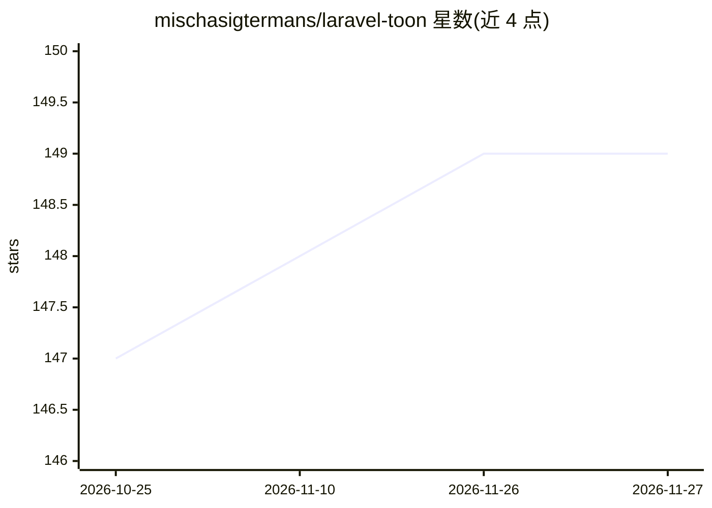

# mischasigtermans/laravel-toon

⭐ 149 · PHP · MIT · 推送 2026-11-09 · [GitHub](https://github.com/mischasigtermans/laravel-toon) · [官网](https://toonformat.dev) · 个人维护

**为 Laravel 提供面向 LLM 的 TOON 数据编码，降低 token 消耗**

Laravel 的 TOON（Token-Oriented Object Notation）编码包，实现 TOON v4.1 规范并通过官方规范测试套件。提供 Facade、全局辅助函数、集合与 Eloquent 模型的 toToon 方法，将数据编码为紧凑的 YAML 风格格式并支持往返解码；含表格/列表/嵌套字段组格式、类型保留、字符串引号转义、可配置省略空值与日期格式化、diff 节省测量等。要求 PHP 8.2+ 与 Laravel 12/13，MIT 许可。

## 筛选速览

| 维度 | 判定 | 备注 |
|---|---|---|
| AI 角色 | `ai-ecosystem` | LLM/agent 周边工具 |
| 许可风险 | `permissive` | MIT |
| 部署形态 | `library` | 以包/库形式分发 |
| 模型依赖 | — | README 未给出锁定关系 |
| 硬件要求 | — | 无带数字的原话,不猜 |
| 安装摩擦 | `low` | 无编译、无系统依赖或容器化 |
| 成熟度 | — | 结构信号不足 |

## 能力要点

- 实现 TOON v4.1 规范，通过官方规范测试套件
- 提供 toToon 集合宏、Eloquent 模型方法与全局辅助函数
- 可配置省略 null/空值/false 以减少 token，支持三种分隔符
- Toon::diff 可测量编码前后的 token/字节差异

## 适用场景

- MCP 服务器工具调用返回数据时减少 token 占用
- 向 LLM 上下文窗口打包更多数据
- 为注重 token 消耗的客户端提供可选 TOON 格式的 API 响应

## 场景标签

`提示工程` · 领域:Agent 开发

## 证据(README 行号)

> L8: TOON (Token-Oriented Object Notation) is a compact, YAML-like format designed to reduce token usage when sending dat
> L76: When building MCP servers or LLM-powered applications, every token counts. JSON's verbosity wastes context window s

## 星数曲线

2026-10-25 147 → 2026-11-27 149（+2）

---
*卡片 v1 · prompt 1.4 · 生成 2026-11-27 · 置信度 mid · 依据 README sha `4b63e8f0308c` · [字段定义](../../DATASET.md)*
