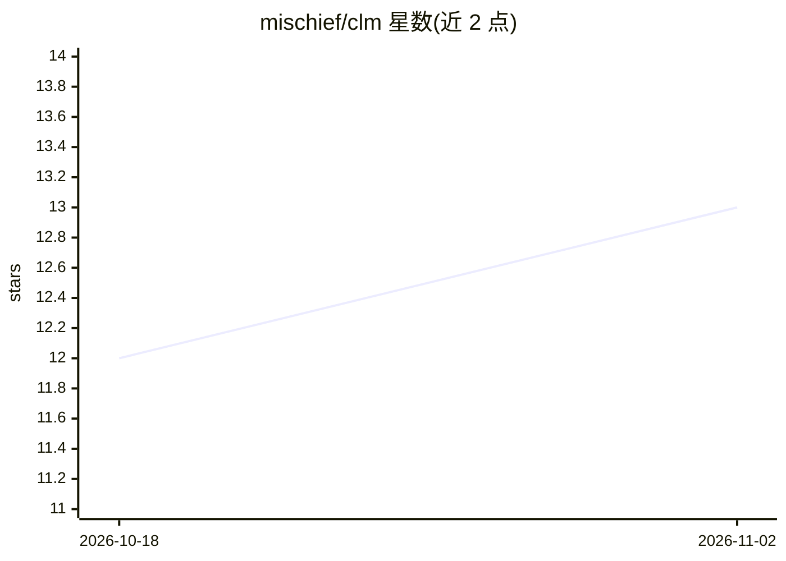

# mischief/clm

⭐ 13 · C · ISC · 推送 2026-10-30 · [GitHub](https://github.com/mischief/clm) · 个人维护

**C 编写的可嵌入 LLM agent，带 Lua 插件与 MCP 客户端**

用 C17 实现的终端 LLM agent，提供 ncurses TUI 与 headless CLI 两种模式。支持 OpenAI 兼容与 Anthropic Messages 两种协议，可在对话中热切换 provider/模型/人格。内置 shell 执行、文件读写工具，Lua 5.4 沙箱插件系统可注册自定义工具并做异步 HTTP 请求，也可通过 require("clm") 从外部驱动 agent。作为 MCP 客户端可接入 stdio/HTTP 服务器的工具。可移植核心仅依赖 cJSON，附 ESP32-S3 嵌入示例。需从源码用 meson 编译，系统依赖包括 libcurl、libuv、Lua 5.4 等。

## 筛选速览

| 维度 | 判定 | 备注 |
|---|---|---|
| AI 角色 | `ai-ecosystem` | LLM/agent 周边工具 |
| 许可风险 | `permissive` | ISC |
| 部署形态 | `None` |  |
| 模型依赖 | local-ok | 支持本地模型 |
| 硬件要求 | — | 无带数字的原话,不猜 |
| 安装摩擦 | `medium` | 含编译或系统依赖之一 |
| 成熟度 | — | 结构信号不足 |

## 能力要点

- OpenAI 兼容与 Anthropic 原生协议双方言，运行时热切换 provider/模型/agent 人格
- Lua 5.4 沙箱插件系统（无 os/io/require、8 MiB 内存上限、异步 HTTP）
- MCP 客户端：从 stdio/HTTP 服务器接入外部工具，崩溃自动重启
- 可移植核心仅依赖 cJSON，提供 ESP32-S3 嵌入示例与 musl 静态构建

## 适用场景

- 在终端以 TUI 或 CLI 与 LLM 对话并执行 shell/文件操作
- 用 Lua 插件为 agent 扩展自定义工具
- 把 agent 核心嵌入到无终端环境（如 ESP32）
- 通过 MCP 接入外部工具服务器

## 场景标签

`AI 助手` `Agent 框架` · 领域:Agent 开发

## 证据(README 行号)

> L3: An embeddable LLM agent in C with a Lua plugin system.
> L17: - Lua 5.4 plugin system for custom tools (sandboxed, async HTTP)
> L20: - MCP client: pull in tools from external

## 星数曲线

2026-10-18 12 → 2026-11-02 13（+1）

---
*卡片 v1 · prompt 1.4 · 生成 2026-11-01 · 置信度 high · 依据 README sha `7bfb244aab82` · [字段定义](../../DATASET.md)*
