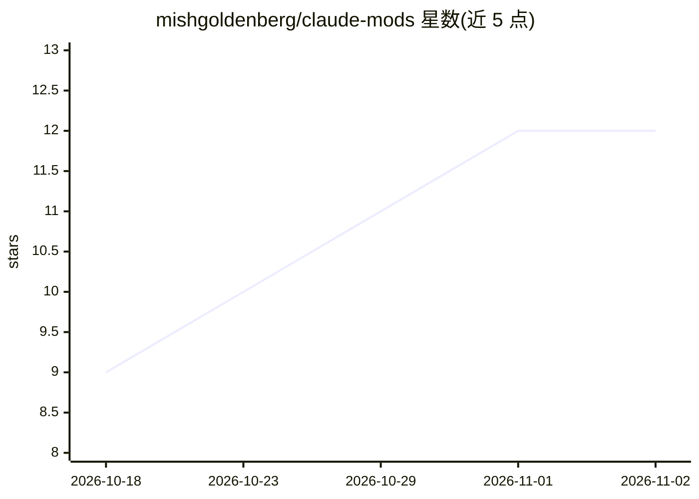

# mishgoldenberg/claude-mods

⭐ 12 · TypeScript · MIT · 推送 2026-10-06 · [GitHub](https://github.com/mishgoldenberg/claude-mods) · 个人维护

**给 Claude Code 用户：面板、防护栏与体验增强插件集**

基于 Claude Code function hooks 进程内插件 API 构建的 11 个独立插件：包括上下文占用面板与压缩前检查点、5小时/7天计划限额与消耗速率仪表、原生系统通知、实时活动监控、可点击的安全规则（拦截 rm -rf、force-push、sudo 等危险命令）、模糊提示词改进建议等。11 个中 9 个不调用模型，2 个（prompt-coach、context-keeper 交接笔记）可选关闭。面向 Claude Code 使用者，通过 plugin marketplace 命令安装，需 Claude Code 2.1.286 或更新版本。

## 筛选速览

| 维度 | 判定 | 备注 |
|---|---|---|
| AI 角色 | `ai-ecosystem` | LLM/agent 周边工具 |
| 许可风险 | `permissive` | MIT |
| 部署形态 | `library` | 以包/库形式分发 |
| 模型依赖 | — | README 未给出锁定关系 |
| 硬件要求 | — | 无带数字的原话,不猜 |
| 安装摩擦 | `low` | 无编译、无系统依赖或容器化 |
| 成熟度 | — | 结构信号不足 |

## 能力要点

- 11 个独立插件，可单独安装或按预设（Safety only/Essentials/Zero tokens 等）组合
- guardrails 拦截危险命令并保留 7 天拦截日志，提供可自定义规则
- 9/11 插件零 token 调用，读取引擎已有数据绘制面板
- 在 Claude Code 终端与桌面应用内原生渲染面板、提示与状态栏

## 适用场景

- 监控上下文窗口占用并在压缩前保存检查点
- 查看计划限额消耗速率与剩余时间
- 拦截 agent 执行危险命令如 rm -rf 或 force-push
- 长任务结束或审批等待时收到系统通知

## 场景标签

`提示工程` `LLM 可观测性` · 领域:Agent 开发

## 证据(README 行号)

> L3: **Panels, guardrails and quality-of-life mods for Claude Code: see what fills your context, how fast you burn your p
> L19: **claude-mods** is a set of small plugins that open that box. Each mod is a standalone Claude Code plugin built on 
> L21: They are deliberately boring about tokens. Nine of the eleven never call a model. The two that do (prompt-coach's r

## 星数曲线

2026-10-18 9 → 2026-11-02 12（+3）

---
*卡片 v1 · prompt 1.4 · 生成 2026-11-01 · 置信度 mid · 依据 README sha `b21750dabdbf` · [字段定义](../../DATASET.md)*
