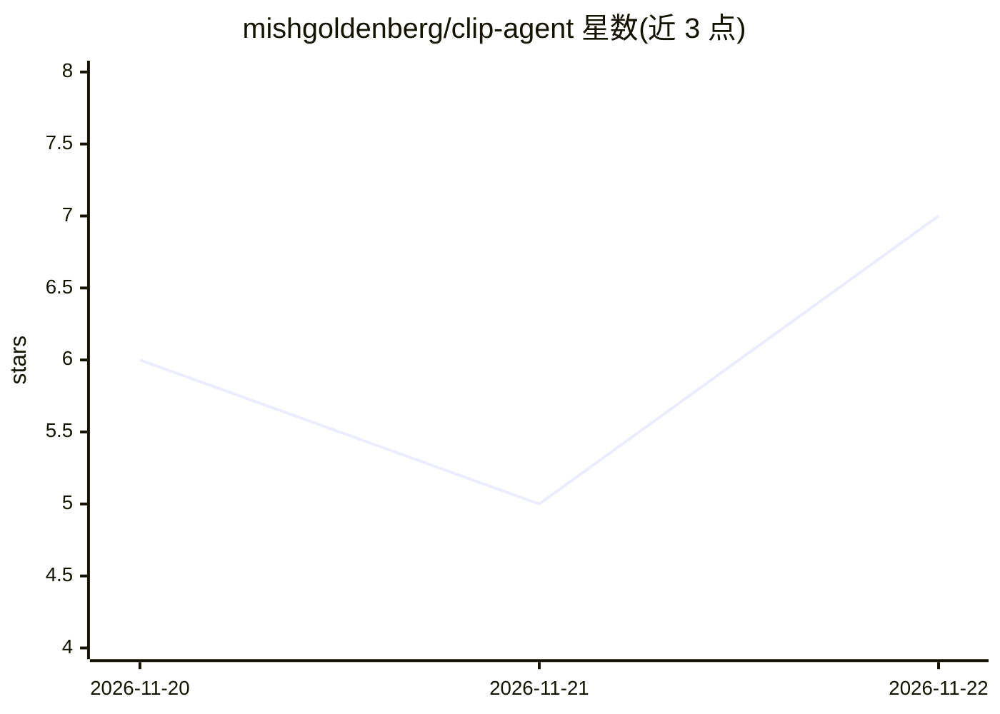

# mishgoldenberg/clip-agent

⭐ 7 · Python · MIT · 推送 2026-11-19 · [GitHub](https://github.com/mishgoldenberg/clip-agent) · 个人维护

**让 AI agent 运营游戏切片频道：找高光、剪辑竖屏短片、署名并排期发布**

以 Claude Code 为运行环境的 Python 项目：下载 Twitch/YouTube/直播/自录素材，用聊天弹幕峰值、音量、灰屏、语音关键词、屏幕模板等信号加权评分定位高光时刻，生成 plan.json 后由 FFmpeg 两遍渲染 9:16 短片（facecam 检测布局、逐词字幕、配音、剧透卡、署名），经人工批准后通过 Buffer 排期发布。Whisper 本地转录，NVIDIA GPU 可加速但非必需。附 GTA 6 预设，其他游戏可通过引导生成预设。

## 筛选速览

| 维度 | 判定 | 备注 |
|---|---|---|
| AI 角色 | `ai-native` | 本体是模型或模型工具 |
| 许可风险 | `permissive` | MIT |
| 部署形态 | `library` | 以包/库形式分发 |
| 模型依赖 | locked-api |  |
| 硬件要求 | — | 无带数字的原话,不猜 |
| 安装摩擦 | `medium` | 含编译或系统依赖之一 |
| 成熟度 | — | 结构信号不足 |

## 能力要点

- 聊天峰值检测：弹幕频率对比滚动基线并结合 hype 词加权定位高光
- 本地 Whisper 转录 + 逐词字幕，本地 Kokoro 配音（可选下载约 350 MB 模型）
- 自动 9:16 布局：检测 facecam 置顶、纯游戏画面用模糊背景缩放
- 创作者署名与一键 takedown，发布前需人工批准

## 适用场景

- 从每日 Twitch 热门片段自动产出竖屏短片并排期到 TikTok/Reels/Shorts
- 为即将上线的新游戏（如 GTA 6）提前搭建切片频道流水线
- 把已有录像或 VOD 剪成带配音与字幕的短片
- 应创作者要求一键下架其所有片段

## 场景标签

`视频生成` · 领域:内容生成

## 证据(README 行号)

> L3: **An AI agent that runs a gaming clip channel for you: finds the best moments, edits them into original vertical sho
> L17: conversation. Open the folder in Claude Code, tell the agent what you
> L61: 3. **Edit:** the agent writes a small `plan.json` (segments, layout, hook, voiceover script), and FFmpeg

## 星数曲线

2026-11-20 6 → 2026-11-22 7（+1）

---
*卡片 v1 · prompt 1.4 · 生成 2026-11-20 · 置信度 high · 依据 README sha `bb1b3a77de57` · [字段定义](../../DATASET.md)*
