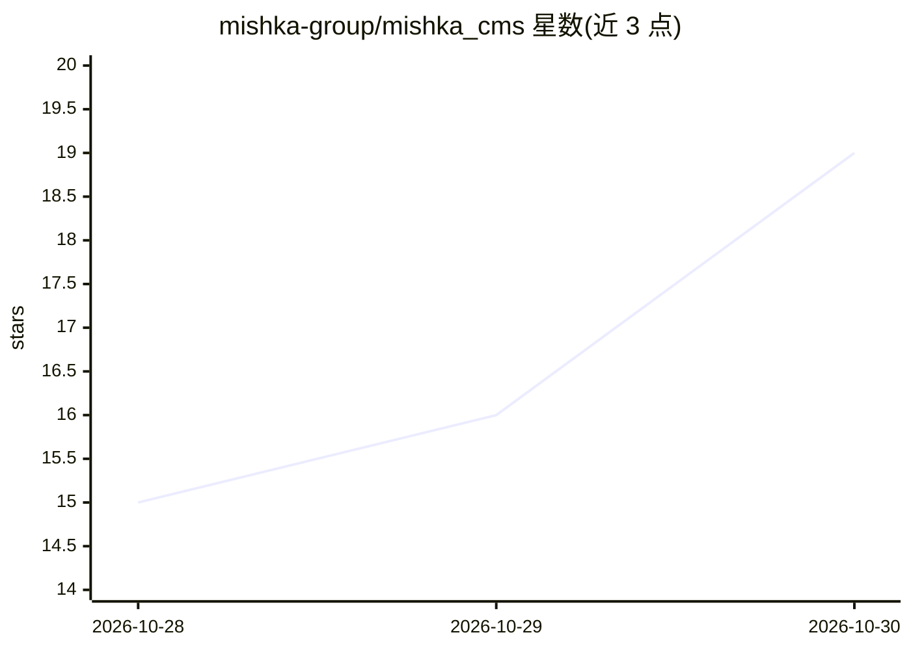

# mishka-group/mishka_cms

⭐ 19 · Elixir · Apache-2.0 · 推送 2026-10-29 · [GitHub](https://github.com/mishka-group/mishka_cms) · [官网](https://mishka.tools/cms) · 组织维护

**多租户实时 CMS：一次部署运行多个网站，带可视化建页**

用 Elixir/Phoenix LiveView 与 Ash 框架编写的开源实时内容管理系统，一次安装可服务多个网站，每个站点作为独立租户拥有自己的域名、语言、页面、组件、媒体与权限。页面、布局、组件存于数据库并运行时编译，支持可视化页面构建器与代码编辑器、草稿预览、版本恢复；发布无需重新部署。AI 助手为可选功能，由用户连接自己的模型。提供 Docker 镜像与源码两种运行方式，需 Elixir 1.20+、PostgreSQL 与 bun。

## 筛选速览

| 维度 | 判定 | 备注 |
|---|---|---|
| AI 角色 | `ai-enhanced` | 去掉 AI 部分产品仍成立 |
| 许可风险 | `permissive` | Apache-2.0 |
| 部署形态 | `self-host` | docker 或自建部署 |
| 模型依赖 | — | README 未给出锁定关系 |
| 硬件要求 | — | 无带数字的原话,不猜 |
| 安装摩擦 | `low` | 无编译、无系统依赖或容器化 |
| 成熟度 | — | 结构信号不足 |

## 能力要点

- 一次安装运行多网站，租户数据相互隔离
- 可视化页面构建器与代码编辑器，草稿自动保存、版本可恢复
- 支持多语言站点、SEO 标签、JSON:API 与 Swagger UI
- 插件事件机制（Mishka Installer）替代 fork 扩展

## 适用场景

- 用一套部署托管多个客户网站并按租户管理权限
- 在浏览器里可视化搭建页面并即时发布
- 通过插件事件系统扩展博客、文档等功能而不 fork 源码

## 场景标签

 · 领域:Web/CMS 建站

## 证据(README 行号)

> L6: **An open source real-time CMS for Elixir and Phoenix LiveView. One install runs many websites.**
> L12: Mishka CMS is an open source real-time CMS written in Elixir on Phoenix LiveView and the Ash framework. One install

## 星数曲线

2026-10-28 15 → 2026-10-30 19（+4）

---
*卡片 v1 · prompt 1.4 · 生成 2026-10-30 · 置信度 high · 依据 README sha `4a5ad3325d3d` · [字段定义](../../DATASET.md)*
