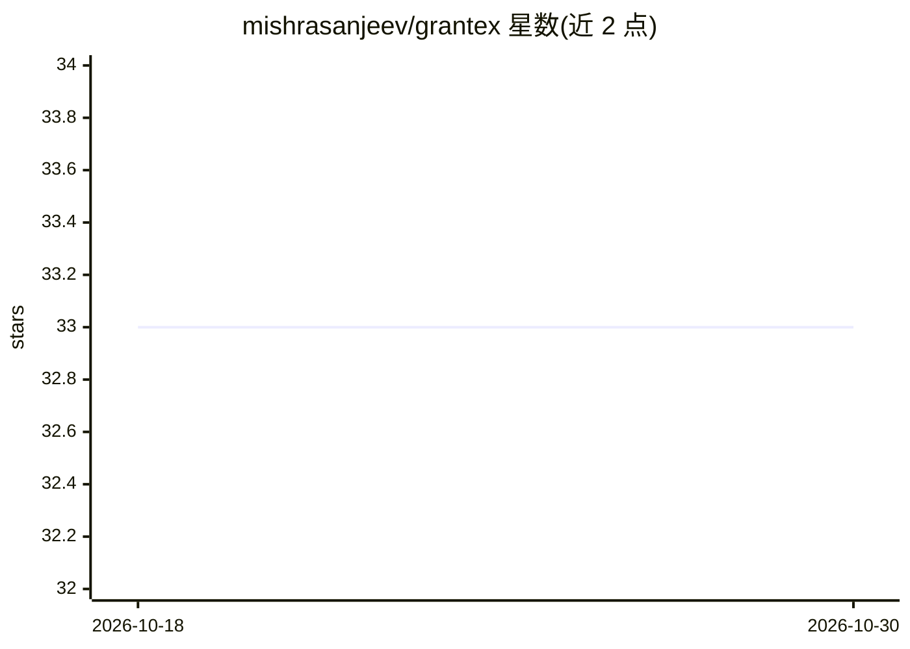

# mishrasanjeev/grantex

⭐ 33 · TypeScript · NOASSERTION · 推送 2026-10-29 · [GitHub](https://github.com/mishrasanjeev/grantex) · [官网](https://grantex.dev) · 组织维护

**面向 AI agent 的委托授权、身份与审计基础设施（SDK+服务）**

Grantex 是为 AI agent 设计的委托授权协议与参考实现：给每个 agent 发可验证身份与来自人或组织的限时、可撤销、限定范围授权，支持多级委托、服务端验证与审计记录，并实现 OAuth Agent Grants 草案（PAR、PKCE S256、DPoP、RFC 7009 撤销）。补充能力包括 agent 预付钱包（x402 v2 支付、PostgreSQL 原子预留、Base USDC EIP-3009）与 OACP 商务授权层。SDK 为 Apache 2.0，服务器为源码可得（Personal Use 1.0），自托管需自行提供 PostgreSQL、HTTPS ingress、托管适配器等依赖。

## 筛选速览

| 维度 | 判定 | 备注 |
|---|---|---|
| AI 角色 | `ai-ecosystem` | LLM/agent 周边工具 |
| 许可风险 | `none` | NOASSERTION |
| 部署形态 | `self-host` | docker 或自建部署 |
| 模型依赖 | — | README 未给出锁定关系 |
| 硬件要求 | — | 无带数字的原话,不猜 |
| 安装摩擦 | `low` | 无编译、无系统依赖或容器化 |
| 成熟度 | — | 结构信号不足 |

## 能力要点

- 可验证 agent 身份 + 限时/可撤销/限定范围的委托授权
- 实现 OAuth Agent Grants 草案（PAR/PKCE S256/DPoP/刷新轮换/撤销），2,138 项服务端测试
- agent 预付钱包：x402 v2、原子预留、策略门控签名与链上对账
- OACP 签发/验签与审计见证检查点

## 适用场景

- 让服务端核验某个 AI agent 能替谁做哪些操作
- 为 agent 配置带预算与止付控制的预付钱包支付
- 记录 agent 委托与决策的不可篡改审计链

## 场景标签

 · 领域:AI agent 安全基础设施

## 证据(README 行号)

> L44: Grantex is a delegated authorization protocol and reference implementation for AI agents, with open-source SDKs and
> L46: Grantex complements OAuth 2.0 and MCP: OAuth handles application and user authorization, MCP connects models to too

## 星数曲线

2026-10-18 33 → 2026-10-30 33（+0）

---
*卡片 v1 · prompt 1.4 · 生成 2026-10-25 · 置信度 high · 依据 README sha `75c84cf281e5` · [字段定义](../../DATASET.md)*
