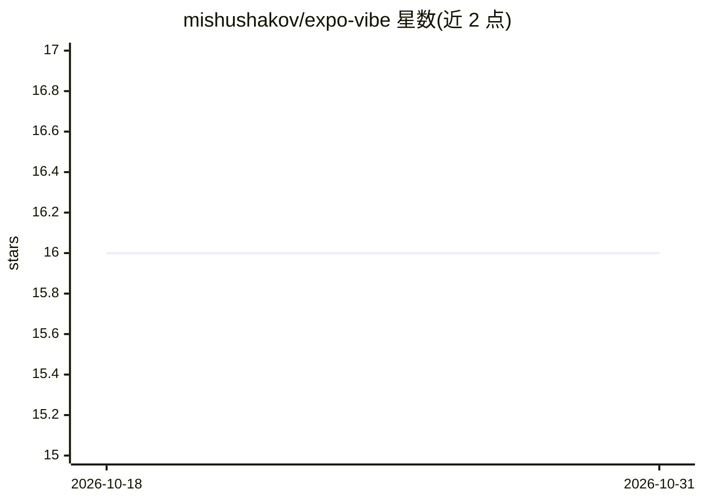

# mishushakov/expo-vibe

⭐ 16 · TypeScript · MIT · 推送 2026-08-12 · [GitHub](https://github.com/mishushakov/expo-vibe) · 个人维护

**通过聊天生成 Expo 应用的 Web/Native 客户端**

基于 Expo 54 与 React 19 构建的 Web 及原生应用：用户在聊天界面与 AI 编码代理对话，每个会话启动独立 E2B 沙箱，调用沙箱内的 OpenCode CLI 编辑 Expo 项目，并通过 iframe/WebView 实时预览生成结果。支持多会话管理、生成文件浏览、Expo 日志回传修复、推送到 GitHub（需 GH_TOKEN）。需配置 E2B_API_KEY 与 OPENAI_API_KEY，会话状态存于本地 Node 进程内存，重启即丢失。

## 筛选速览

| 维度 | 判定 | 备注 |
|---|---|---|
| AI 角色 | `ai-native` | 本体是模型或模型工具 |
| 许可风险 | `permissive` | MIT |
| 部署形态 | `library` | 以包/库形式分发 |
| 模型依赖 | — | README 未给出锁定关系 |
| 硬件要求 | — | 无带数字的原话,不猜 |
| 安装摩擦 | `low` | 无编译、无系统依赖或容器化 |
| 成熟度 | — | 结构信号不足 |

## 能力要点

- 每个聊天会话对应独立 E2B 沙箱与生成的 Expo 应用
- 沙箱内运行 OpenCode CLI 编辑项目并流式返回工具事件
- iframe/WebView 实时预览，支持 Expo Go 二维码与外部打开
- 浏览生成文件、查看 Expo 日志并回传聊天修复

## 适用场景

- 通过对话让 AI 编码代理替我搭建 Expo 应用
- 迭代修改沙箱中生成的 Expo 项目并实时预览
- 把聊天生成的应用推送到 GitHub

## 场景标签

`编码 Agent` · 领域:编码与开发

## 证据(README 行号)

> L3: Expo Vibe is a web and native Expo app for generating Expo applications through a chat interface. Each chat spins up
> L24: - OpenCode CLI inside each sandbox

## 星数曲线

2026-10-18 16 → 2026-10-31 16（+0）

---
*卡片 v1 · prompt 1.4 · 生成 2026-10-30 · 置信度 high · 依据 README sha `2eb4bd1ba101` · [字段定义](../../DATASET.md)*
