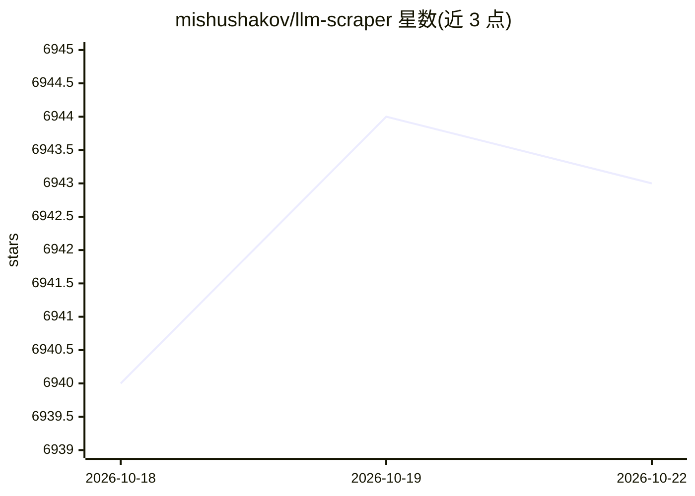

# mishushakov/llm-scraper

⭐ 6,946 · TypeScript · MIT · 推送 2026-10-21 · [GitHub](https://github.com/mishushakov/llm-scraper) · 个人维护

**用 LLM 把网页提取为结构化数据的 TypeScript 库**

基于 Playwright 的 TypeScript 库：加载网页后按 Zod/JSON Schema 定义的模型产出结构化数据，支持 GPT、Claude、Gemini、Llama、Qwen 等模型系列（经 Vercel AI SDK 生态接入，含 OpenAI/Anthropic/Google/Groq/Ollama 初始化示例）。提供 6 种内容格式化模式（html/raw_html/markdown/text/image/custom）、流式对象输出，以及按 schema 生成可复用 Playwright 脚本的代码生成功能。从 npm 安装，面向 TypeScript 开发者。

## 筛选速览

| 维度 | 判定 | 备注 |
|---|---|---|
| AI 角色 | `ai-native` | 本体是模型或模型工具 |
| 许可风险 | `permissive` | MIT |
| 部署形态 | `library` | 以包/库形式分发 |
| 模型依赖 | local-ok | 支持本地模型 |
| 硬件要求 | — | 无带数字的原话,不猜 |
| 安装摩擦 | `low` | 无编译、无系统依赖或容器化 |
| 成熟度 | — | 结构信号不足 |

## 能力要点

- Zod/JSON Schema 定义输出结构，TypeScript 全类型安全
- 6 种内容格式化模式，含截图多模态输入
- 流式输出部分对象
- generate 函数按 schema 生成可复用的 Playwright 抓取脚本

## 适用场景

- 从任意网页提取结构化数据（如 HackerNews 热榜）
- 用本地或云端 LLM 做带 schema 约束的网页抽取
- 生成可复用的 Playwright 抓取脚本

## 场景标签

`网页抓取` · 领域:效率与自动化

## 证据(README 行号)

> L5: LLM Scraper is a TypeScript library that allows you to extract structured data from **any** webpage using LLMs.
> L14: - Supports GPT, Sonnet, Gemini, Llama, Qwen model series

## 星数曲线

2026-10-18 6,940 → 2026-10-22 6,943（+3）

---
*卡片 v1 · prompt 1.4 · 生成 2026-10-20 · 置信度 high · 依据 README sha `ea58d8b89e0b` · [字段定义](../../DATASET.md)*
