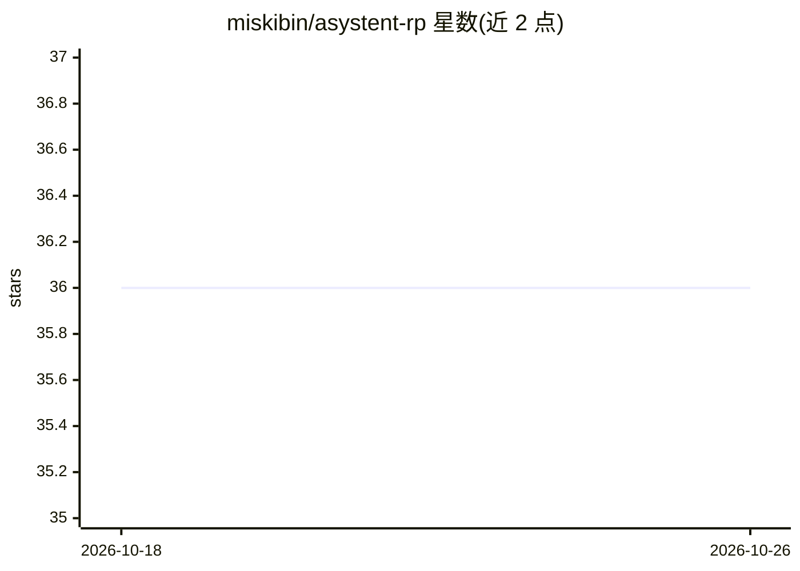

# miskibin/asystent-rp

⭐ 36 · TypeScript · 推送 2026-10-09 · [GitHub](https://github.com/miskibin/asystent-rp) · [官网](https://chat.tygodniksejmowy.pl) · 个人维护

**波兰法律与议会数据的 Web AI 问答助手**

基于 Next.js 的 Web 应用：通过 DeepSeek 模型与三个读取 Tygodnik Sejmowy（波兰议会周刊）数据的工具，帮助用户分析议会数据、法律条文、投票与发言，并起草公文草稿。回答带可核查的条款引用与版本标识；未确认时效或上下文不完整时停止生成并返回带链接的限制说明。登录、会话与权限由 Supabase 处理，需配置 DeepSeek API key 并部署 Supabase 迁移后以 npm 运行。

## 筛选速览

| 维度 | 判定 | 备注 |
|---|---|---|
| AI 角色 | `ai-native` | 本体是模型或模型工具 |
| 许可风险 | `none` | — |
| 部署形态 | `None` |  |
| 模型依赖 | locked-api |  |
| 硬件要求 | — | 无带数字的原话,不猜 |
| 安装摩擦 | `low` | 无编译、无系统依赖或容器化 |
| 成熟度 | — | 结构信号不足 |

## 能力要点

- 三个法律条文工具（搜索/获取/变更追踪），引用保留条文锚点与版本标识
- 未确认来源时效或不完整上下文时拒绝生成并返回可核查限制
- 界面展示实际工作步骤（议会数据检索、文档读取、条文核查）
- 支持最多 3 个文本文件（TXT/MD/CSV/JSON/XML/YAML/LOG，共 12000 字符）上传

## 适用场景

- 查询波兰法律条文的现行版本与变更记录
- 分析波兰议会投票、法案与议员发言数据
- 在 AI 辅助下起草公文草稿

## 场景标签

`聊天机器人` `文档问答` `AI 写作` · 领域:对话与助手

## 证据(README 行号)

> L13: Asystent RP pomaga analizować dane Sejmu, ustawy, głosowania i wypowiedzi oraz przygotowywać robocze pisma. Odpowie
> L31: Wymagane: Node.js 24, npm, projekt Supabase z konfiguracją OAuth oraz klucz DeepSeek. Skopiuj `.env.example` do `.e

## 星数曲线

2026-10-18 36 → 2026-10-26 36（+0）

---
*卡片 v1 · prompt 1.4 · 生成 2026-10-25 · 置信度 high · 依据 README sha `b155ae87796d` · [字段定义](../../DATASET.md)*
