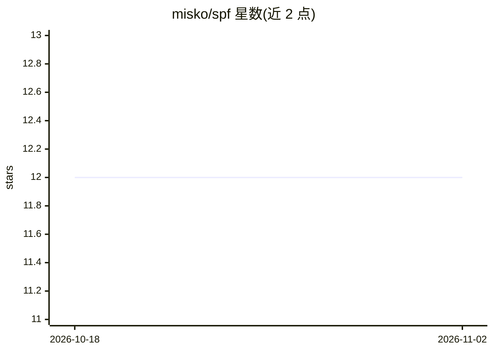

# misko/spf

⭐ 12 · Python · 推送 2026-09-12 · [GitHub](https://github.com/misko/spf) · 个人维护

**移动无线电接收机定位射频发射源（如无人机）的算法系统**

面向射频发射源定位研究的信号处理项目：给定移动无线电接收机（机载或地面小车），通过波束成形将天线阵列信号映射为角度-强度图，结合扩展卡尔曼滤波、粒子滤波及神经网络增强滤波生成发射源位置概率地图，并用运动规划算法计算最优移动路径。支持 PlutoSDR 与 BladeRF 2.0 硬件、GRBL/MAVLink 平台控制，含仿真数据生成与测试套件。当前无法同时跟踪多个发射源（README 标注 soon）。

## 筛选速览

| 维度 | 判定 | 备注 |
|---|---|---|
| AI 角色 | `ai-native` | 本体是模型或模型工具 |
| 许可风险 | `none` | — |
| 部署形态 | `library` | 以包/库形式分发 |
| 模型依赖 | — | README 未给出锁定关系 |
| 硬件要求 | — | 无带数字的原话,不猜 |
| 安装摩擦 | `medium` | 含编译或系统依赖之一 |
| 成熟度 | — | 结构信号不足 |

## 能力要点

- EKF/粒子滤波/神经网络增强滤波多种发射源跟踪实现
- PlutoSDR 与 BladeRF 2.0 硬件接入，跨平台抽象接口
- GRBL 小车与 MAVLink 无人机（含仿真）运动控制与路径规划
- 仿真环境与合成数据生成，无需硬件即可做算法开发

## 适用场景

- 研究通过移动接收机以最小路径定位射频发射源
- 无人机等射频设备的检测与定位实验
- 在仿真环境中开发测试波束成形与滤波算法

## 场景标签

`科研工具` · 领域:学习与行业

## 证据(README 行号)

> L71:  - Neural network enhanced variants (`particle_single_radio_nn_filter.py`, `particle_dual_radio_nn_filter.py`)
> L80: - Advanced deep learning architectures in `spf/model_training_and_inference/models/`:
> L221: - **Neural Network Enhanced Filters** combine traditional filtering approaches with learned components to better h

## 星数曲线

2026-10-18 12 → 2026-11-02 12（+0）

---
*卡片 v1 · prompt 1.4 · 生成 2026-11-01 · 置信度 mid · 依据 README sha `ffc2de368cec` · [字段定义](../../DATASET.md)*
