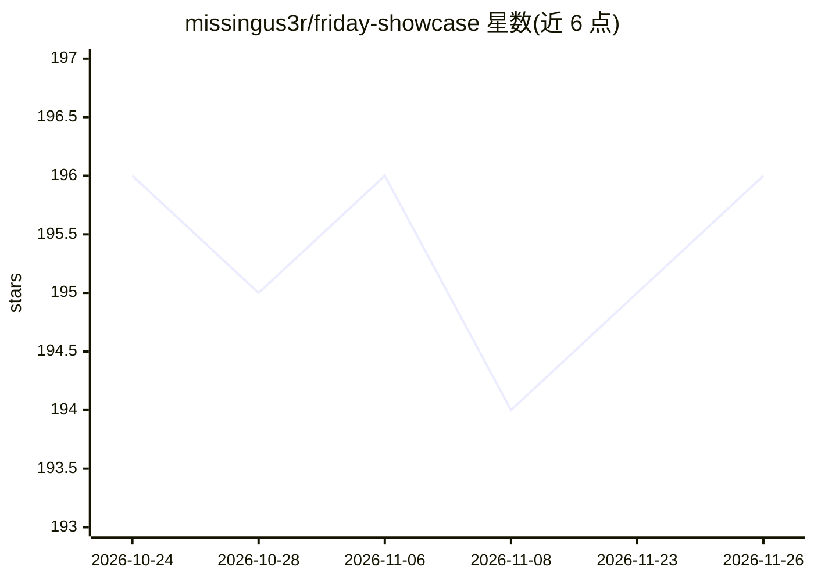

# missingus3r/friday-showcase

⭐ 196 · HTML · 推送 2026-10-28 · [GitHub](https://github.com/missingus3r/friday-showcase) · [官网](https://missingus3r.github.io/friday-showcase/) · 个人维护

**基于 Claude Code 的 24/7 Telegram 个人 AI 助手**

以 Anthropic Claude Code CLI 为核心运行时、通过 Telegram 交互的个人助理系统：执行定时任务、管理文件与项目、维护跨会话持久记忆，并具备自我演化机制——技能习得、每日反思、偏好学习、世界建模与改进提案（须经用户批准）。记忆层为 Flask + SQLite 单文件服务，嵌入以 BLOB 存储于同一 SQLite，无外部向量库。运行于标准 Windows/Linux/macOS 机器，依赖 Claude Code Max 订阅（$100/月），仓库本身不含可直接克隆的成品代码，由 SETUP.md 驱动 Claude Code 生成实现。

## 筛选速览

| 维度 | 判定 | 备注 |
|---|---|---|
| AI 角色 | `ai-native` | 本体是模型或模型工具 |
| 许可风险 | `none` | — |
| 部署形态 | `None` |  |
| 模型依赖 | locked-api |  |
| 硬件要求 | — | 无带数字的原话,不猜 |
| 安装摩擦 | `low` | 无编译、无系统依赖或容器化 |
| 成熟度 | — | 结构信号不足 |

## 能力要点

- 以 Claude Code CLI 为唯一运行时，无编排框架与微调模型
- 五个自我演化子系统：技能习得、每日反思、偏好学习、世界模型、改进提案
- Flask + SQLite 单文件记忆服务，支持混合检索与 D3.js 可视化
- 可选 YOLOv8n 本地摄像头人物检测，数据不出本机

## 适用场景

- 通过 Telegram 随时与个人助理对话、布置任务与接收主动消息
- 让助手定时推送天气、汇率、AI 新闻等简报
- 积累个人偏好与记忆，跨会话保持上下文
- 本地监控安防摄像头并在检测到人时告警

## 场景标签

`AI 助手` `目标检测` · 领域:对话与助手

## 证据(README 行号)

> L11: A self-evolving AI assistant that runs 24/7 on a standard Windows, Linux, or macOS machine. It talks over Telegram,
> L75: - **Voice messages** — transcribes audio in (ElevenLabs Scribe STT), replies with synthesized speech (ElevenLabs TT
> L82: - **Skill acquisition** — extracts reusable patterns from solved tasks, stored with trigger patterns

## 星数曲线

2026-10-24 196 → 2026-11-26 196（+0）

---
*卡片 v1 · prompt 1.4 · 生成 2026-11-25 · 置信度 high · 依据 README sha `e6b787c9826f` · [字段定义](../../DATASET.md)*
