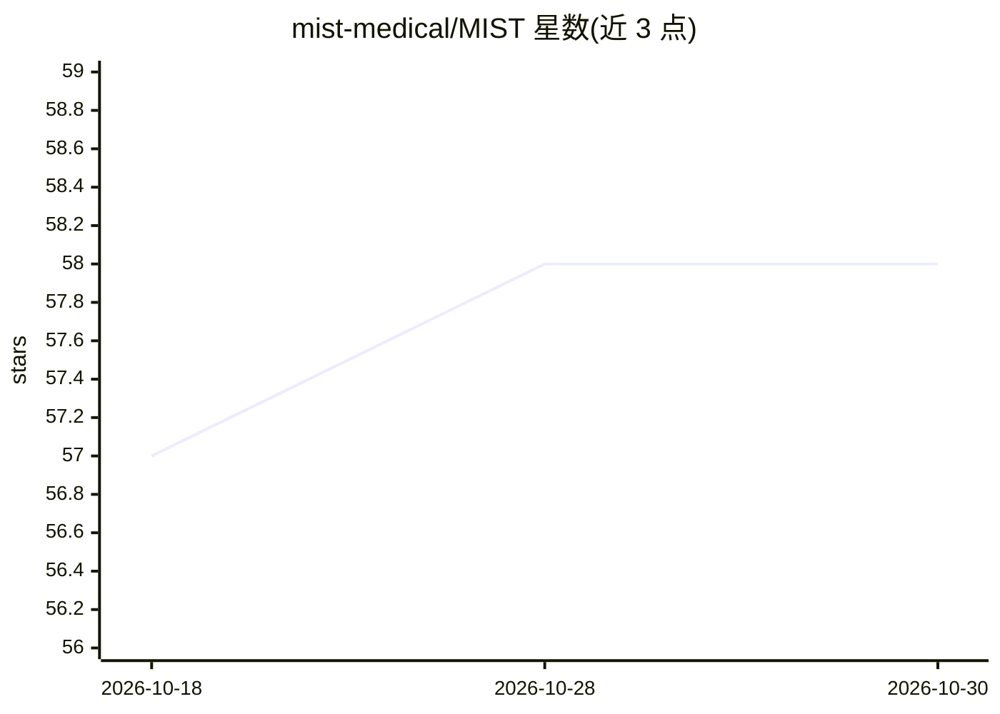

# mist-medical/MIST

⭐ 58 · Python · Apache-2.0 · 推送 2026-10-03 · [GitHub](https://github.com/mist-medical/MIST) · 组织维护

**面向医学影像研究者的 3D 医学图像分割端到端框架**

MIST 是覆盖原始 NIfTI 文件到训练模型与预测评估全流程的 3D 医学图像分割框架：通过数据集 JSON 描述数据，一条 mist_run_all 命令完成 analyze→preprocess→train→evaluate。分析步骤自动确定目标间距、patch 尺寸与归一化策略；默认五折交叉验证，支持 PyTorch DDP 多 GPU（CUDA/ROCm）与 CPU 训练，训练时可选用 NVIDIA DALI 加速数据加载。内置 nnU-Net、MedNeXt、Swin UNETR 等 7 类架构和多种 Dice/边界损失。pip 安装，提供 Docker 镜像与 Colab 演示。

## 筛选速览

| 维度 | 判定 | 备注 |
|---|---|---|
| AI 角色 | `ai-native` | 本体是模型或模型工具 |
| 许可风险 | `permissive` | Apache-2.0 |
| 部署形态 | `self-host` | docker 或自建部署 |
| 模型依赖 | — | README 未给出锁定关系 |
| 硬件要求 | `cpu-ok` | |
| 安装摩擦 | `low` | 无编译、无系统依赖或容器化 |
| 成熟度 | — | 结构信号不足 |

## 能力要点

- analyze→preprocess→train→evaluate→predict 端到端流水线，默认五折交叉验证
- 自动配置：从数据推断目标间距、patch 尺寸、归一化与前景裁剪
- 支持 CUDA/ROCm 多 GPU DDP 训练与 CPU 全流程运行
- 7 类架构（nnU-Net/MedNeXt/Swin UNETR 等）与多种复合损失函数

## 适用场景

- 在 BraTS 等医学影像数据集上训练并评估分割模型
- 将 Medical Segmentation Decathlon 数据集转换为训练格式
- 对新病例批量执行推理与后处理并生成评估结果

## 场景标签

`目标检测` · 领域:感知与多模态

## 证据(README 行号)

> L8: MIST is a simple, scalable, end-to-end framework for 3D medical image
> L97: - **Automatic configuration** — analysis step determines target spacing, patch

## 星数曲线

2026-10-18 57 → 2026-10-30 58（+1）

---
*卡片 v1 · prompt 1.4 · 生成 2026-10-24 · 置信度 high · 依据 README sha `1a5d6b3cc36b` · [字段定义](../../DATASET.md)*
