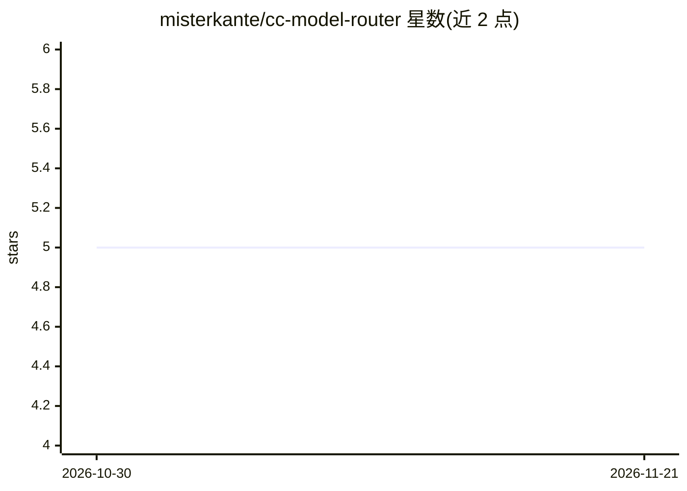

# misterkante/cc-model-router

⭐ 5 · JavaScript · MIT · 推送 2026-10-27 · [GitHub](https://github.com/misterkante/cc-model-router) · [官网](https://github.com/misterkante/cc-model-router) · 个人维护

**为 Claude Code 用户按任务分级路由 Haiku/Sonnet/Opus 以降低成本**

cc-model-router 是一个 CLI 与 Claude Code 原生插件：对每个任务进行三级分类（mechanical/implementation/debugging），映射到 Haiku/Sonnet/Opus 并设置 effort 与 fallback 模型。CLI 路径 `ccmr run` 支持 `--verify` 运行确定性检查命令、`--escalate` 失败后升级到下一档重试；插件按轮次改写模型，支持 per-turn/session/off 与 cache-aware 切换模式。配置分全局与项目两层，提供 48 次运行的成本/通过率基准数据与沙箱测试脚本。要求 Node.js >= 18 及支持 `--effort`/`--fallback-model` 的 Claude Code 版本。

## 筛选速览

| 维度 | 判定 | 备注 |
|---|---|---|
| AI 角色 | `ai-ecosystem` | LLM/agent 周边工具 |
| 许可风险 | `permissive` | MIT |
| 部署形态 | `library` | 以包/库形式分发 |
| 模型依赖 | locked-api |  |
| 硬件要求 | — | 无带数字的原话,不猜 |
| 安装摩擦 | `low` | 无编译、无系统依赖或容器化 |
| 成熟度 | `idea` | |

## 能力要点

- 任务三级分类并映射到 Haiku/Sonnet/Opus，含 confidence 与关键词输出
- --verify 确定性检查 + --escalate 失败升级重试机制
- 原生 Claude Code 插件按轮次路由，支持 cache-aware 与冷却降档
- 附 48 次运行基准（12 任务 × 2 变体 × 2 重复）与可复现脚本

## 适用场景

- 降低 Claude Code 日常会话的 token 开销
- 机械性任务（git 操作、格式化、lint）自动落到低成本模型
- 代码实现任务失败后自动升级到更高档模型重试

## 场景标签

`编码 Agent` `模型网关` · 领域:Agent 开发

## 证据(README 行号)

> L5: > Automatic model routing for Claude Code — classify each task, pick the cheapest model that can do it, never type `
> L75: 3. `ccmr run` maps the tier to `--model`, `--effort` and `--fallback-model`, then launches Claude Code.
> L79: `ccmr run` remains the quality-gated path: it applies one model at launch and can verify and escalate. The plugin i

## 星数曲线

2026-10-30 5 → 2026-11-21 5（+0）

---
*卡片 v1 · prompt 1.4 · 生成 2026-11-21 · 置信度 high · 依据 README sha `c86cedd7c348` · [字段定义](../../DATASET.md)*
