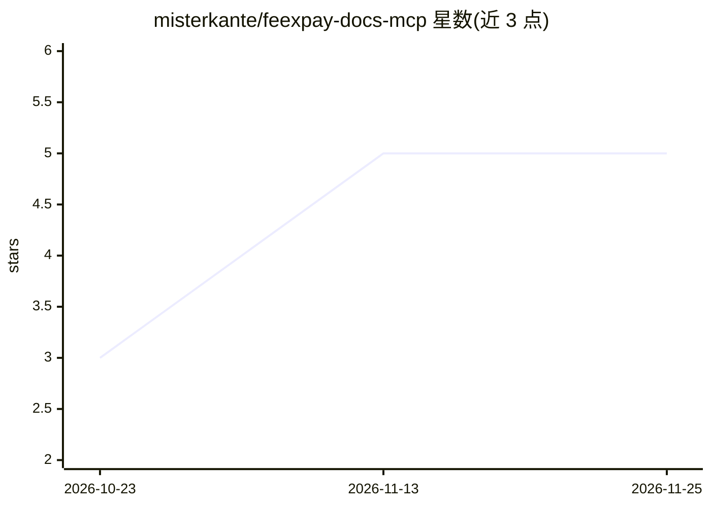

# misterkante/feexpay-docs-mcp

⭐ 5 · JavaScript · NOASSERTION · 推送 2026-11-17 · [GitHub](https://github.com/misterkante/feexpay-docs-mcp) · 个人维护

**给 AI 助手提供 FeexPay 支付文档实时检索的 MCP 服务器**

非官方 MCP 服务器，将 FeexPay（西非/中非支付聚合商）的 API v2 文档每日抓取为 Markdown 快照并提供给 AI 助手。提供 search_docs、list_sections、get_section、get_all_docs 四个工具，覆盖全部 40 个文档章节、每个国家/网络变体，支持英文与法文。快照由 GitHub Action 每日更新，运行时从 GitHub 读取，离线时回退到内置快照。仅读取文档，不能发起支付；Node.js 18+ 运行，无 API key 与浏览器依赖。

## 筛选速览

| 维度 | 判定 | 备注 |
|---|---|---|
| AI 角色 | `ai-ecosystem` | LLM/agent 周边工具 |
| 许可风险 | `permissive` | NOASSERTION |
| 部署形态 | `library` | 以包/库形式分发 |
| 模型依赖 | — | README 未给出锁定关系 |
| 硬件要求 | — | 无带数字的原话,不猜 |
| 安装摩擦 | `low` | 无编译、无系统依赖或容器化 |
| 成熟度 | — | 结构信号不足 |

## 能力要点

- 4 个 MCP 工具：全文搜索、章节列表、单章节读取、全文档输出
- 每日 GitHub Action 抓取，运行时读最新快照，无需升级包
- 离线回退到内置快照，内存缓存 6 小时
- 英文/法文双语文档，含每个国家/网络的端点变体

## 适用场景

- 让 Claude/Cursor 等助手基于真实端点编写 FeexPay 集成代码
- 查询某国 Mobile Money payout 支持的网络与请求体格式
- 查询 FeexPay 错误码含义与 webhook、SDK 用法

## 场景标签

`文档问答` · 领域:知识与检索

## 证据(README 行号)

> L1: # FeexPay Docs MCP
> L17: claude mcp add feexpay-docs -- npx -y github:misterkante/feexpay-docs-mcp
> L46: This server renders every page, clicks through every country and network tab, converts everything to clean Markdown

## 星数曲线

2026-10-23 3 → 2026-11-25 5（+2）

---
*卡片 v1 · prompt 1.4 · 生成 2026-11-21 · 置信度 high · 依据 README sha `54ef6d2cd72a` · [字段定义](../../DATASET.md)*
