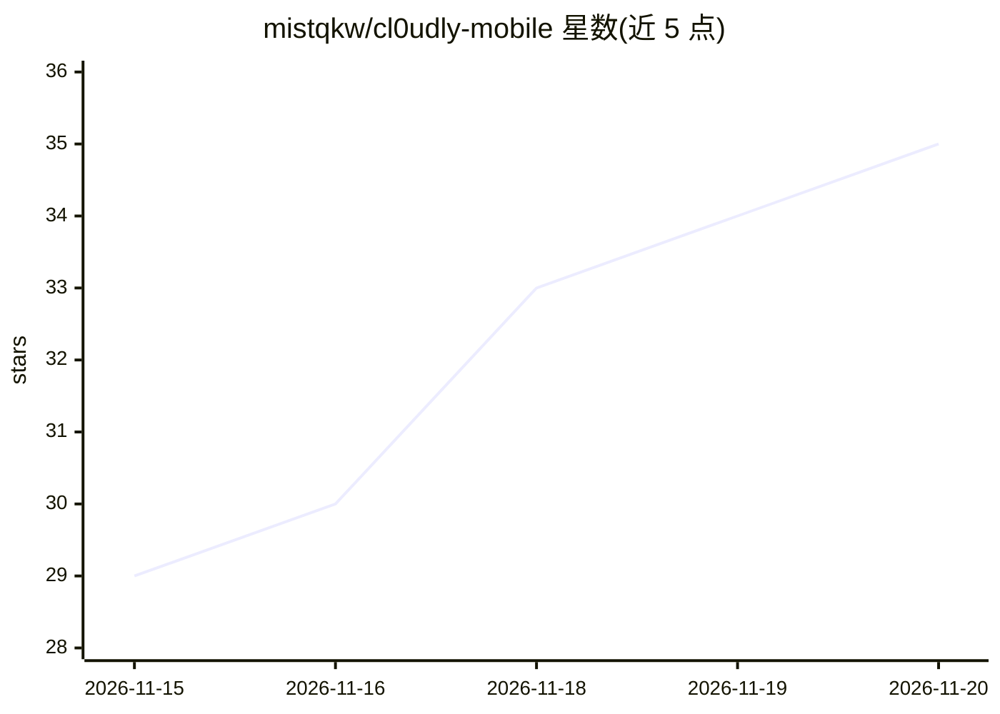

# mistqkw/cl0udly-mobile

⭐ 35 · Kotlin · MIT · 推送 2026-11-16 · [GitHub](https://github.com/mistqkw/cl0udly-mobile) · 个人维护

**在 Android 手机上本地运行 OpenCode 服务端的 AI 编程代理客户端**

非官方 Android 客户端：通过 proot（免 root）解包 Ubuntu 24.04，在手机上启动 OpenCode 1.x 服务端（127.0.0.1）并以 Jetpack Compose 移动 UI 呈现，也可扫码连接电脑上的 OpenCode。功能含多子代理团队、技能（SKILL.md，可导入 Claude/ChatGPT 技能）、GitHub 登录与 PR 操作、手机工具 MCP 服务器（通知/拍照/定位等）、markdown 记忆与用量统计。模型经 OpenCode Zen/Go、Copilot、Pollinations 或自备 key。当前为 v0.0.1 beta-4，Android 8+ arm64，targetSdk 28、仅以 APK 分发。

## 筛选速览

| 维度 | 判定 | 备注 |
|---|---|---|
| AI 角色 | `ai-native` | 本体是模型或模型工具 |
| 许可风险 | `permissive` | MIT |
| 部署形态 | `None` |  |
| 模型依赖 | — | README 未给出锁定关系 |
| 硬件要求 | — | 无带数字的原话,不猜 |
| 安装摩擦 | `medium` | 含编译或系统依赖之一 |
| 成熟度 | `idea` | |

## 能力要点

- proot 内运行完整 OpenCode 服务端，无需电脑与 root
- 技能兼容 SKILL.md，可导入 Claude/ChatGPT 技能与自定义 GPT 指令
- MCP 服务器向代理开放手机能力（通知、拍照、定位、剪贴板等）
- 扫码连接同网络的电脑上运行的 OpenCode

## 适用场景

- 不带电脑时用手机完成 AI 编程代理任务
- 把手机作为代理的操作对象（设提醒、拍照、保存分享文件）
- 导入已有 Claude/ChatGPT 技能在手机上复用

## 场景标签

`编码 Agent` · 领域:编码与开发

## 证据(README 行号)

> L3: An Android app that runs its own OpenCode server on the phone. It unpacks Ubuntu 24.04 in proot (no root), starts `o
> L15: **Team of agents.** Turn on a team in Settings → Capabilities → Team. Either define the helpers yourself (name, rol
> L35: **Models.** OpenCode Zen and Go (sign in from the app), the free models, GitHub Copilot, Pollinations without an ac

## 星数曲线

2026-11-15 29 → 2026-11-20 35（+6）

---
*卡片 v1 · prompt 1.4 · 生成 2026-11-18 · 置信度 high · 依据 README sha `6df749a84651` · [字段定义](../../DATASET.md)*
