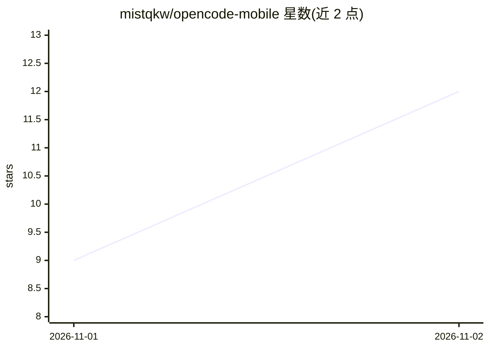

# mistqkw/opencode-mobile

⭐ 12 · Kotlin · MIT · 推送 2026-10-30 · [GitHub](https://github.com/mistqkw/opencode-mobile) · 个人维护

**在 Android 手机上本地运行 OpenCode 服务端的 AI 编程客户端**

非官方 Android 客户端：通过 proot 免 root 解包 Ubuntu 24.04，在手机上启动 opencode serve（127.0.0.1）并配以移动端界面，也可连接电脑上已运行的 OpenCode。功能包括导入 SKILL.md 技能、GitHub 设备码登录后由 agent 代为 clone/commit/push/开 PR、通过 MCP 暴露手机工具（通知、提醒、拍照、定位、剪贴板等）、锁屏进度与权限确认、用量环显示与备份迁移。模型接入 OpenCode Zen/Go 免费模型、Copilot、Pollinations 或自有 key。当前 v0.0.1 beta-3，Android 8+ arm64，仅 APK 分发，主要在 Pixel 上测试。

## 筛选速览

| 维度 | 判定 | 备注 |
|---|---|---|
| AI 角色 | `ai-native` | 本体是模型或模型工具 |
| 许可风险 | `permissive` | MIT |
| 部署形态 | `None` |  |
| 模型依赖 | — | README 未给出锁定关系 |
| 硬件要求 | — | 无带数字的原话,不猜 |
| 安装摩擦 | `medium` | 含编译或系统依赖之一 |
| 成熟度 | `idea` | |

## 能力要点

- proot 内运行完整 OpenCode 服务端，无需 root 与电脑
- MCP 暴露手机工具（通知/拍照/定位/剪贴板/分享），各工具可开关
- 导入 Claude/ChatGPT 的 SKILL.md 技能或自定义 GPT 指令
- GitHub 设备码登录后 agent 可代为提交与开 PR

## 适用场景

- 手机上独立使用 OpenCode AI 编程 agent，不依赖电脑
- 把手机能力（通知、相机、定位）交给 agent 调用
- 在移动设备上管理技能、记忆与 GitHub 仓库操作

## 场景标签

`编码 Agent` · 领域:编码与开发

## 证据(README 行号)

> L3: An Android app that runs its own OpenCode server on the phone. It unpacks Ubuntu 24.04 in proot (no root), starts `o
> L29: **Models.** OpenCode Zen and Go (sign in from the app), the free models, GitHub Copilot, Pollinations without an ac

## 星数曲线

2026-11-01 9 → 2026-11-02 12（+3）

---
*卡片 v1 · prompt 1.4 · 生成 2026-11-02 · 置信度 high · 依据 README sha `175a58fae94b` · [字段定义](../../DATASET.md)*
