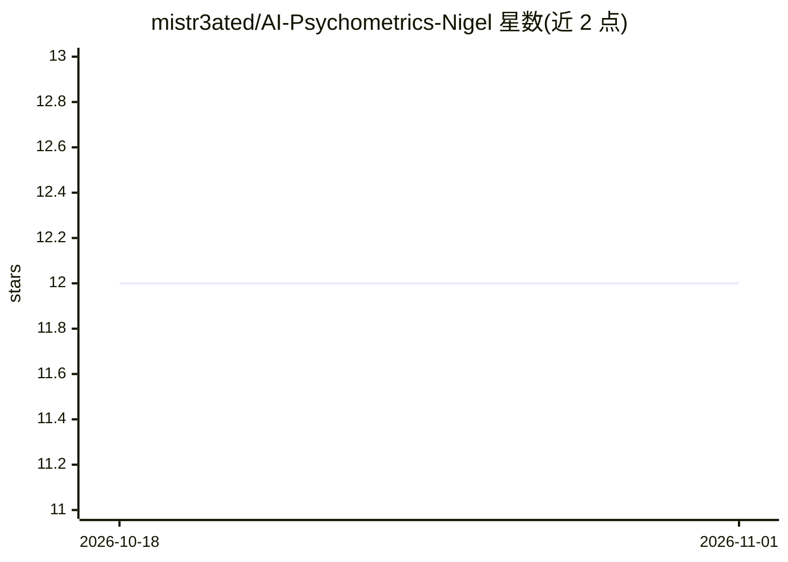

# mistr3ated/AI-Psychometrics-Nigel

⭐ 12 · MIT · 推送 2026-08-03 · [GitHub](https://github.com/mistr3ated/AI-Psychometrics-Nigel) · [官网](https://psychometrics.ai) · 个人维护

**将深度学习与 LLM 应用于心理测量的实验代码集（配套书籍）**

心理学家 Nicolas Guénolé 配套其免费书籍 psychometrics.ai 的实验代码仓库：包含若干新方法（语义项目对齐、伪因子分析、LLM 凸包）、MiniLM 编码器与 GPT-2 small 解码器的高精度解耦重建、从零编写的约 5100 万参数教育用 LLM Seedling（PyTorch 实现，loss=4.63）、基于 IPIP 数据库带重排序的 RAG 项目生成、XAI 置换检验示例、Ollama 本地项目生成，以及基于嵌入的测量不变性/DIF 检验演示。书籍内容采用 CC BY-NC 4.0，代码采用 MIT 许可。

## 筛选速览

| 维度 | 判定 | 备注 |
|---|---|---|
| AI 角色 | `ai-native` | 本体是模型或模型工具 |
| 许可风险 | `permissive` | MIT |
| 部署形态 | `None` |  |
| 模型依赖 | — | README 未给出锁定关系 |
| 硬件要求 | — | 无带数字的原话,不猜 |
| 安装摩擦 | `low` | 无编译、无系统依赖或容器化 |
| 成熟度 | `idea` | |

## 能力要点

- 语义项目对齐、伪因子分析、LLM 凸包等心理测量新方法
- 从零实现的 ~51M 参数 GPT-2 风格 LLM Seedling（单文件 PyTorch）
- 基于嵌入的测量不变性与 DIF 检验（数据采集前即可检查）
- MiniLM 与 GPT-2 small 的高精度解耦重建

## 适用场景

- 学习深度学习方法在心理测量中的应用
- 用嵌入在数据采集前检查测量不变性与 DIF
- 参考 Seedling 了解小型 LLM 的从零实现

## 场景标签

`教程课程` · 领域:学习与行业

## 证据(README 行号)

> L3: I am a psychologist interested in how artificial intelligence can help improve psychometric assessment. This reposit
> L6: - New methods inc. **Semantic Item Alignment**, **Pseudo-Factor-Analysis** and **LLM Convex Hulls**,
> L22: **Seedling** is a GPT-2–style, ~51 million parameter LLM, coded from scratch in PyTorch with AI assistance. You can

## 星数曲线

2026-10-18 12 → 2026-11-01 12（+0）

---
*卡片 v1 · prompt 1.4 · 生成 2026-11-01 · 置信度 high · 依据 README sha `a6e6c5d0f926` · [字段定义](../../DATASET.md)*
