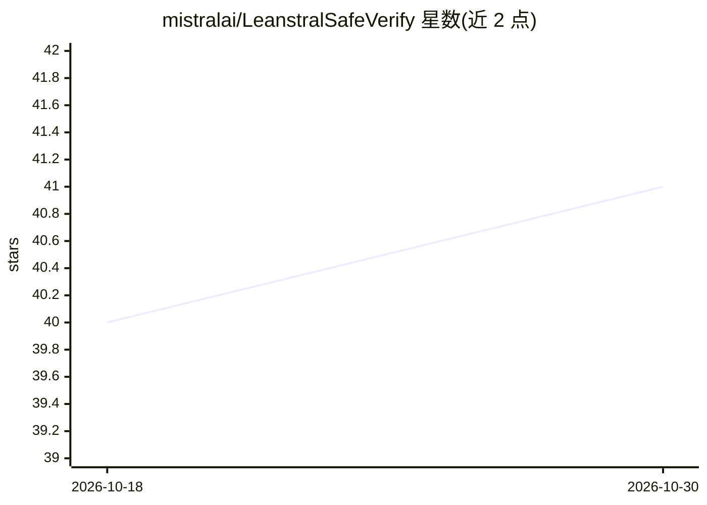

# mistralai/LeanstralSafeVerify

⭐ 41 · Lean · Apache-2.0 · 推送 2026-07-03 · [GitHub](https://github.com/mistralai/LeanstralSafeVerify) · 组织维护

**Lean 代码/证明的安全校验器：核验提交是否匹配规范**

SafeVerify 的 Mistral AI（Leanstral）分支，用于代码 agent 训练与评测流程。读取两个 olean 文件，检查第二个文件是否实现第一个文件指定的定理与定义：通过 Environment.replay 重放声明防范元编程环境操纵，核对声明名/种类/类型与定义体，限制仅使用三个标准公理（propext、Quot.sound、Classical.choice），并拒绝 partial/unsafe 定义。代码改编自 lean4checker。提供分支适配不同 Lean 版本以校验 DeepSeek Prover V2、Kimina、Trinity、Seed Prover 等的 MiniF2F 解答。限制：不检查 implemented_by/extern/noncomputable 等源码级关键字。

## 筛选速览

| 维度 | 判定 | 备注 |
|---|---|---|
| AI 角色 | `ai-ecosystem` | LLM/agent 周边工具 |
| 许可风险 | `permissive` | Apache-2.0 |
| 部署形态 | `None` |  |
| 模型依赖 | — | README 未给出锁定关系 |
| 硬件要求 | — | 无带数字的原话,不猜 |
| 安装摩擦 | `low` | 无编译、无系统依赖或容器化 |
| 成熟度 | — | 结构信号不足 |

## 能力要点

- Environment.replay 重放机制防范环境操纵
- 限制仅依赖三个标准公理，AllowedAxioms 列表可调
- 拒绝 partial/unsafe 定义，防无限循环满足类型要求
- 多分支适配 Lean 4.9–4.20，用于校验多家 prover 的 MiniF2F 解答

## 适用场景

- 作为编程竞赛/证明任务的答案校验后端
- 训练与评测 Lean 代码 agent 时防止元编程或额外公理作弊
- 核对自动定理证明器提交的证明是否严格匹配规范

## 场景标签

`模型评测` · 领域:评测与运维

## 证据(README 行号)

> L3: The purpose of this script is to check whether a file of submitted Lean code and/or proof matches the specifications
> L11: The branch `minif2f-deepseek-check` contains a version backported to Lean 4.9.0. This can be used to check DeepSeek

## 星数曲线

2026-10-18 40 → 2026-10-30 41（+1）

---
*卡片 v1 · prompt 1.4 · 生成 2026-10-25 · 置信度 high · 依据 README sha `f4608a47110a` · [字段定义](../../DATASET.md)*
