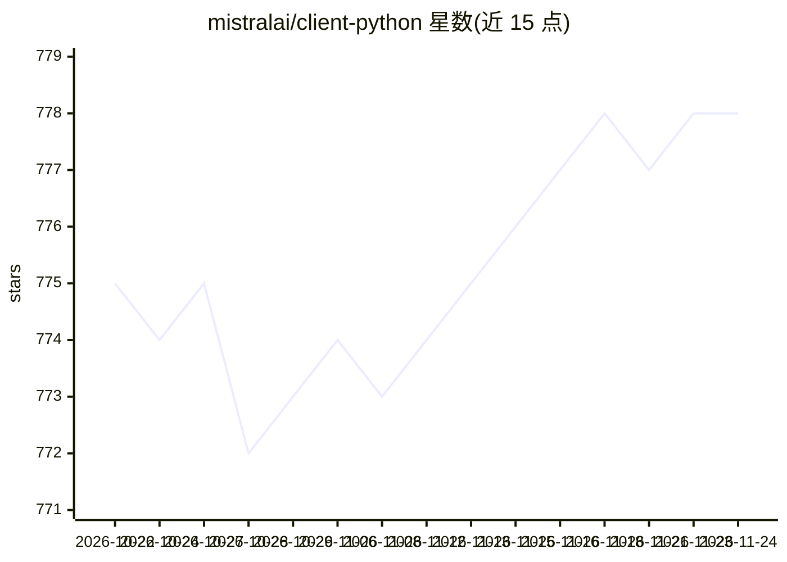

# mistralai/client-python

⭐ 778 · Python · Apache-2.0 · 推送 2026-11-18 · [GitHub](https://github.com/mistralai/client-python) · 组织维护

**Mistral AI 平台的官方 Python SDK 客户端**

面向 Mistral AI 平台（La Plateforme）的 Python 客户端库，封装 Chat Completion、Embeddings、Agents、Audio（语音/转录/会话）、Batch、Conversations、Connectors、Managed Index 等资源的 API 调用。支持 uv/pip/poetry 安装，agents 与 voice-agents 功能需安装额外依赖包；同时提供 Azure AI 与 Google Cloud Vertex 部署路径的专用客户端类。凭据支持环境变量、每请求 Authorization header、可调用对象及服务账户 token 文件（支持轮换）。

## 筛选速览

| 维度 | 判定 | 备注 |
|---|---|---|
| AI 角色 | `ai-ecosystem` | LLM/agent 周边工具 |
| 许可风险 | `permissive` | Apache-2.0 |
| 部署形态 | `library` | 以包/库形式分发 |
| 模型依赖 | — | README 未给出锁定关系 |
| 硬件要求 | — | 无带数字的原话,不猜 |
| 安装摩擦 | `low` | 无编译、无系统依赖或容器化 |
| 成熟度 | — | 结构信号不足 |

## 能力要点

- 覆盖 Chat/Embeddings/Agents/Audio/Batch/Conversations 等资源的完整 API 封装
- 支持同步与异步请求两种调用方式
- 提供 Azure AI（MistralAzure）与 Google Cloud Vertex（MistralGCP）专用客户端
- 服务账户 token 文件每次请求重新读取，支持凭据轮换

## 适用场景

- 在 Python 应用中调用 Mistral 的对话与嵌入 API
- 在 Azure 或 GCP 上通过 SDK 访问已部署的 Mistral 模型
- 构建语音 agent 会话与转录、语音合成应用

## 场景标签

 · 领域:LLM 基础设施/SDK

## 证据(README 行号)

> L1: # Mistral Python Client
> L31: Mistral AI API: Our Chat Completion and Embeddings APIs specification. Create your account on La Plateforme to get 

## 星数曲线

2026-10-22 775 → 2026-11-24 778（+3）

---
*卡片 v1 · prompt 1.4 · 生成 2026-11-24 · 置信度 high · 依据 README sha `2d60f8acf3cb` · [字段定义](../../DATASET.md)*
