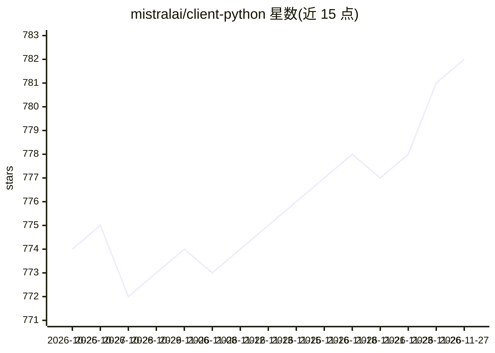

# mistralai/client-python

⭐ 782 · Python · Apache-2.0 · 推送 2026-11-24 · [GitHub](https://github.com/mistralai/client-python) · 组织维护

**Mistral AI 平台的官方 Python SDK 客户端**

Mistral AI 官方维护的 Python 客户端库，封装 La Plateforme 平台的 Chat Completion、Embeddings、Agents、音频（语音/转录）、批处理、文件上传、会话与连接器等 API。支持同步与异步调用、流式输出，凭据通过环境变量、服务账户令牌文件或每请求 Authorization 头解析。可通过 uv/pip/poetry 安装，并针对 Azure AI 与 Google Cloud Vertex AI 部署提供专用客户端入口，agents 与 voice-agents 功能需安装 extras 依赖。

## 筛选速览

| 维度 | 判定 | 备注 |
|---|---|---|
| AI 角色 | `ai-ecosystem` | LLM/agent 周边工具 |
| 许可风险 | `permissive` | Apache-2.0 |
| 部署形态 | `library` | 以包/库形式分发 |
| 模型依赖 | — | README 未给出锁定关系 |
| 硬件要求 | — | 无带数字的原话,不猜 |
| 安装摩擦 | `low` | 无编译、无系统依赖或容器化 |
| 成熟度 | — | 结构信号不足 |

## 能力要点

- 封装 Chat Completion、Embeddings、Agents、音频、批处理等平台 API
- 支持同步/异步请求与流式输出
- 提供 Azure AI 与 Google Cloud Vertex AI 的专用客户端
- 凭据解析支持环境变量与服务账户令牌文件（每次请求重读，支持轮换）

## 适用场景

- 在 Python 应用中调用 Mistral 的聊天与嵌入接口
- 为使用 Mistral 的 Agent/对话应用编写后端代码
- 在 Azure 或 GCP 上调用部署的 Mistral 模型
- 批量任务、文件管理与语音转录的脚本化操作

## 场景标签

 · 领域:LLM 基础设施/API 客户端

## 证据(README 行号)

> L1: # Mistral Python Client
> L31: Mistral AI API: Our Chat Completion and Embeddings APIs specification. Create your account on La Plateforme to get 
> L266: ## Available Resources and Operations

## 星数曲线

2026-10-25 774 → 2026-11-27 782（+8）

---
*卡片 v1 · prompt 1.4 · 生成 2026-11-26 · 置信度 high · 依据 README sha `6263848f583a` · [字段定义](../../DATASET.md)*
