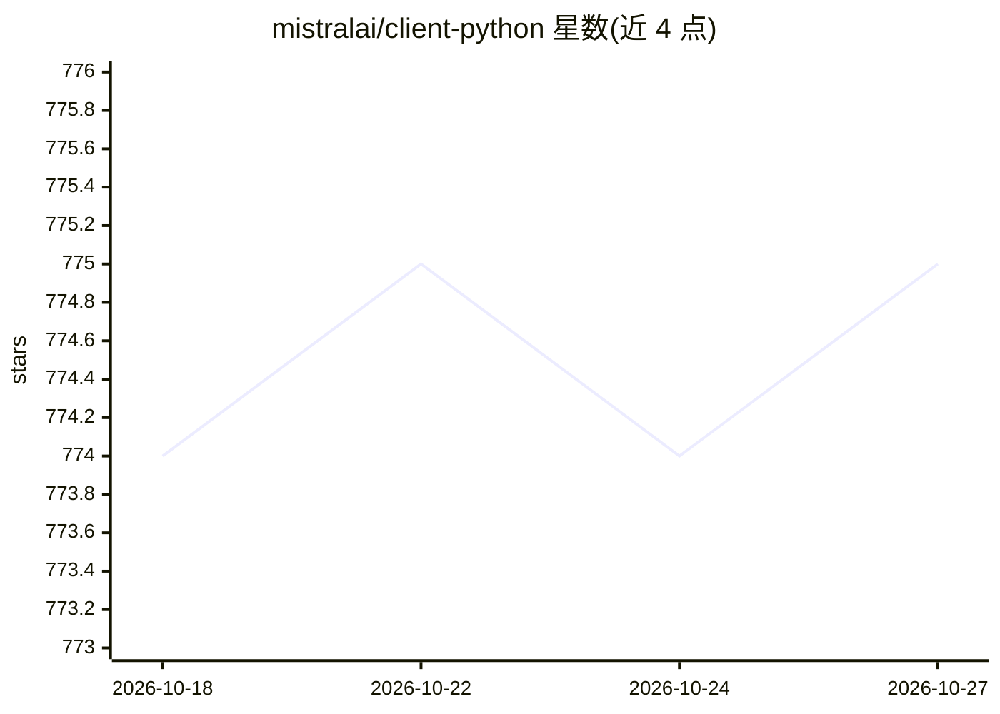

# mistralai/client-python

⭐ 775 · Python · Apache-2.0 · 推送 2026-10-25 · [GitHub](https://github.com/mistralai/client-python) · 组织维护

**Mistral AI 平台的官方 Python SDK，供开发者调用其 API**

由 Mistral AI 维护的官方 Python 客户端库，封装 La Plateforme 的 Chat Completions、Embeddings、Agents、音频（语音/转录/声音）、Batch 任务、Connectors、Conversations、Libraries 与 Observability 数据集等接口，提供同步与异步两种调用方式。支持以 API key 或服务账号 token 鉴权，并含接入 Azure AI 与 Google Cloud（Vertex AI）部署的专用客户端，GCP 认证需额外安装 mistralai[gcp]。可用 uv、pip 或 poetry 安装，agents 与 voice-agents 功能需相应 extras，最低 Python 3.10。

## 筛选速览

| 维度 | 判定 | 备注 |
|---|---|---|
| AI 角色 | `ai-ecosystem` | LLM/agent 周边工具 |
| 许可风险 | `permissive` | Apache-2.0 |
| 部署形态 | `library` | 以包/库形式分发 |
| 模型依赖 | — | README 未给出锁定关系 |
| 硬件要求 | — | 无带数字的原话,不猜 |
| 安装摩擦 | `low` | 无编译、无系统依赖或容器化 |
| 成熟度 | — | 结构信号不足 |

## 能力要点

- 覆盖 Chat/Embeddings/Agents/音频转录与合成/Batch/Connectors 等完整 API 面
- 同步与异步双模式调用
- Azure AI 与 Google Cloud 部署的专用客户端（MistralAzure / MistralGCP）
- 多层级凭据解析：请求头显式 key > api_key 参数 > 服务账号 token 文件 > 环境变量

## 适用场景

- 在 Python 项目中集成 Mistral 的对话与向量嵌入能力
- 通过 SDK 管理与调用 Mistral 平台上的 Agent 与语音会话
- 访问部署在 Azure AI 或 Vertex AI 上的 Mistral 模型
- 批量任务与文档库（Libraries）的自动化处理

## 场景标签

 · 领域:LLM 基础设施/API 客户端

## 证据(README 行号)

> L35: Mistral AI API: Our Chat Completion and Embeddings APIs specification. Create your account on La Plateforme to get 
> L130: from mistralai.client import Mistral

## 星数曲线

2026-10-18 774 → 2026-10-27 775（+1）

---
*卡片 v1 · prompt 1.4 · 生成 2026-10-21 · 置信度 high · 依据 README sha `d0e245ab1bbb` · [字段定义](../../DATASET.md)*
