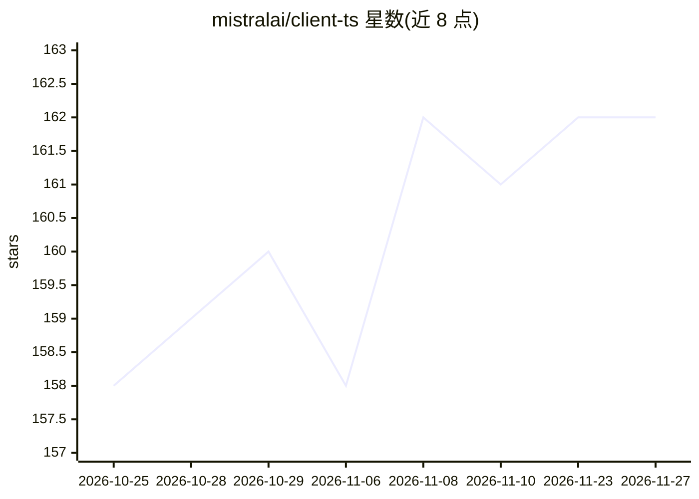

# mistralai/client-ts

⭐ 162 · TypeScript · Apache-2.0 · 推送 2026-11-23 · [GitHub](https://github.com/mistralai/client-ts) · 组织维护

**Mistral AI 平台的 TypeScript SDK，接入聊天/嵌入等 API**

Mistral AI 官方 TypeScript 客户端库，封装 La Plateforme 平台的 Chat Completion 与 Embeddings API，另覆盖 Agents、语音（转录/合成/音色）、批处理、连接器、检索索引、对话、文档库、可观测性（评测/裁判/追踪/日志）与 Prompt 管理等接口。通过 npm/pnpm/bun/yarn 安装，仅以 ESM 发布；需自备 Mistral API Key，支持环境变量、逐请求 header、构造函数传参与服务账号 token 文件（支持轮换）等多种凭证方式。

## 筛选速览

| 维度 | 判定 | 备注 |
|---|---|---|
| AI 角色 | `ai-ecosystem` | LLM/agent 周边工具 |
| 许可风险 | `permissive` | Apache-2.0 |
| 部署形态 | `library` | 以包/库形式分发 |
| 模型依赖 | — | README 未给出锁定关系 |
| 硬件要求 | — | 无带数字的原话,不猜 |
| 安装摩擦 | `low` | 无编译、无系统依赖或容器化 |
| 成熟度 | — | 结构信号不足 |

## 能力要点

- 封装 Chat Completion 与 Embeddings API
- 覆盖 Agents、语音、批处理、对话、可观测性等资源操作
- 多种凭证方式：环境变量/API key/服务账号 token 文件（自动轮换）
- 支持 npm/pnpm/bun/yarn 安装，ESM-only 发布

## 适用场景

- 在 Node/TypeScript 项目中调用 Mistral 聊天与嵌入模型
- 接入 Agent 会话与语音转录/合成接口
- 管理文档库与检索索引
- 接入评测、裁判与追踪等可观测性能力

## 场景标签

 · 领域:LLM 基础设施/API 客户端

## 证据(README 行号)

> L1: # Mistral Typescript Client
> L5: Mistral AI API: Our Chat Completion and Embeddings APIs specification. Create your account on La Plateforme to get a
> L16: npm add @mistralai/mistralai

## 星数曲线

2026-10-25 158 → 2026-11-27 162（+4）

---
*卡片 v1 · prompt 1.4 · 生成 2026-11-27 · 置信度 high · 依据 README sha `47f813ad75ca` · [字段定义](../../DATASET.md)*
