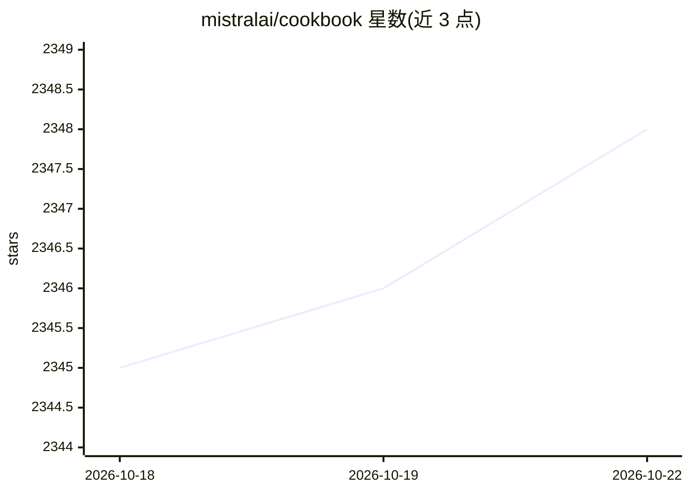

# mistralai/cookbook

⭐ 2,348 · Jupyter Notebook · MIT · 推送 2026-10-14 · [GitHub](https://github.com/mistralai/cookbook) · 组织维护

**Mistral 官方示例集：API、RAG、Agent 等 notebook 教程**

由 Mistral 及其社区、合作伙伴贡献的示例教程仓库，以 notebook 与 Markdown 形式展示 Mistral 模型与 API 的用法，涵盖 chat、embeddings、RAG、function calling、评估、moderation、OCR、数据生成、微调与 agent 构建等类别。另收录 LangChain、LlamaIndex、Ollama、Arize Phoenix 等第三方工具的集成示例。提交需符合格式（.md/.ipynb、尽量可在 Colab 运行、标注包版本）等规范；仓库内含 Quarto 本地预览站点。

## 筛选速览

| 维度 | 判定 | 备注 |
|---|---|---|
| AI 角色 | `ai-knowledge` | 知识聚合/清单类 |
| 许可风险 | `permissive` | MIT |
| 部署形态 | `None` |  |
| 模型依赖 | — | README 未给出锁定关系 |
| 硬件要求 | — | 无带数字的原话,不猜 |
| 安装摩擦 | `low` | 无编译、无系统依赖或容器化 |
| 成熟度 | — | 结构信号不足 |

## 能力要点

- 30 余个官方示例 notebook，覆盖 RAG、function calling、评估、OCR、moderation 等
- 第三方工具示例表收录 LangChain、LlamaIndex、Ollama、MLflow 等集成
- 提供基于 Quarto 的本地预览站点（不执行 notebook 代码）

## 适用场景

- 学习 Mistral API 的 RAG、function calling 等用法
- 查找 Mistral 与 LangChain/LlamaIndex 等框架的集成示例
- 参考评估、moderation、OCR 等场景的实现模板

## 场景标签

`教程课程` · 领域:学习与行业

## 证据(README 行号)

> L3: The Mistral Cookbook features examples contributed by Mistralers and our community, as well as our partners. If you 
> L9: |Notebook|Category|Description|

## 星数曲线

2026-10-18 2,345 → 2026-10-22 2,348（+3）

---
*卡片 v1 · prompt 1.4 · 生成 2026-10-21 · 置信度 high · 依据 README sha `bcfb93030f28` · [字段定义](../../DATASET.md)*
