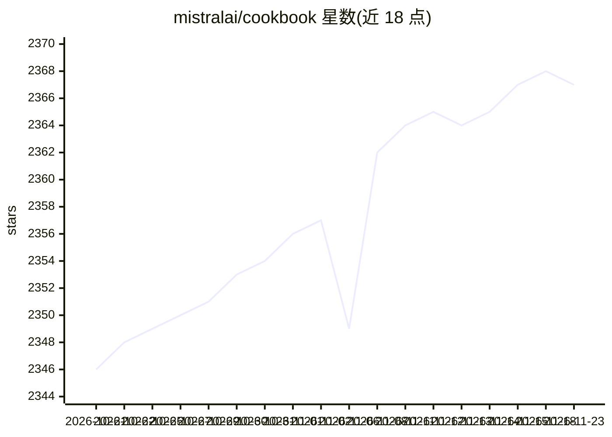

# mistralai/cookbook

⭐ 2,367 · Jupyter Notebook · MIT · 推送 2026-11-19 · [GitHub](https://github.com/mistralai/cookbook) · 组织维护

**Mistral 模型用例示例集：官方与社区贡献的 notebook 合集**

由 Mistral AI 维护的示例手册仓库，收录官方与社区、合作伙伴贡献的 notebook 和 Markdown 示例，覆盖聊天、嵌入、RAG、function calling、评估、OCR、内容审核、agent 等类别，第三方部分展示与 LangChain、LLamaIndex、Ollama 等工具的搭配用法。仓库提供提交规范（格式、Colab 可运行、版本标注）和基于 Quarto 的本地预览站点用于浏览内容，预览不执行 notebook 代码。

## 筛选速览

| 维度 | 判定 | 备注 |
|---|---|---|
| AI 角色 | `ai-knowledge` | 知识聚合/清单类 |
| 许可风险 | `permissive` | MIT |
| 部署形态 | `None` |  |
| 模型依赖 | — | README 未给出锁定关系 |
| 硬件要求 | — | 无带数字的原话,不猜 |
| 安装摩擦 | `low` | 无编译、无系统依赖或容器化 |
| 成熟度 | — | 结构信号不足 |

## 能力要点

- 主 notebooks 覆盖 RAG、function calling、OCR、评估、审核、agent 等类别
- 第三方工具章节收录与 LangChain、LLamaIndex、Ollama 等的搭配示例
- 提供 Quarto 本地预览站点，渲染已提交的 notebook 内容
- 接受社区通过 PR 提交示例并有提交规范

## 适用场景

- 学习如何调用 Mistral API 实现 RAG 和 function calling
- 查找 Mistral 模型与主流框架搭配的示例代码
- 参考 OCR、结构化输出、内容审核等具体用例的写法

## 场景标签

`教程课程` · 领域:学习与行业

## 证据(README 行号)

> L3: The Mistral Cookbook features examples contributed by Mistralers and our community, as well as our partners. If you 
> L9: |Notebook|Category|Description|

## 星数曲线

2026-10-21 2,346 → 2026-11-23 2,367（+21）

---
*卡片 v1 · prompt 1.4 · 生成 2026-11-23 · 置信度 high · 依据 README sha `203b598de661` · [字段定义](../../DATASET.md)*
