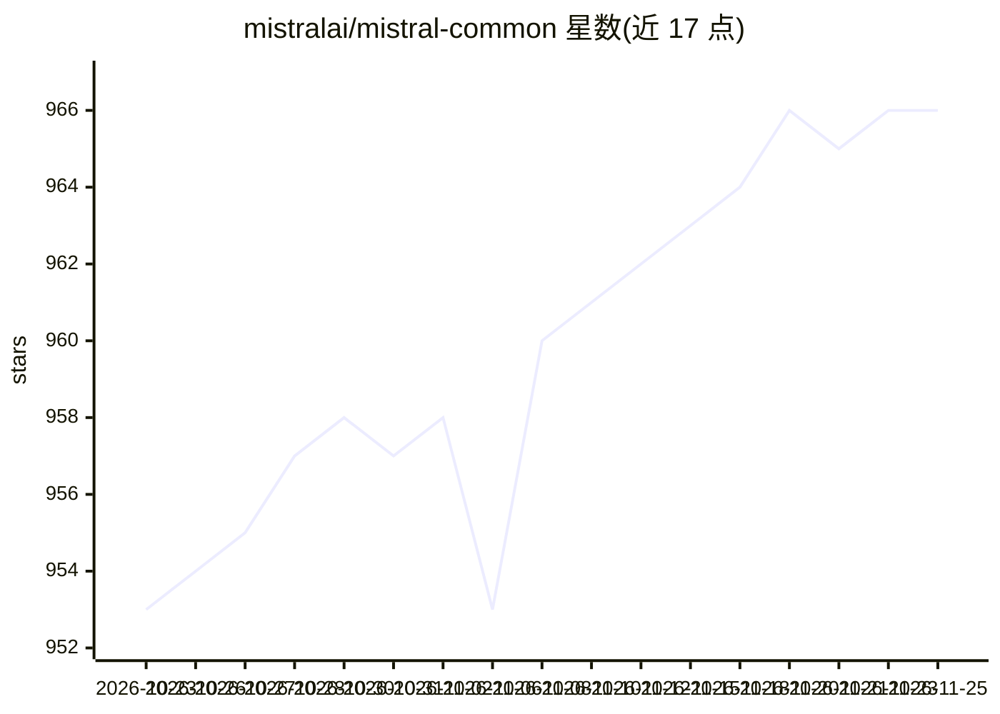

# mistralai/mistral-common

⭐ 966 · Python · Apache-2.0 · 推送 2026-11-23 · [GitHub](https://github.com/mistralai/mistral-common) · 组织维护

**Mistral 模型官方推理预处理库：分词与请求校验**

Mistral AI 官方开源的推理工具库，提供其模型的 tokenizer、请求校验与规范化代码，覆盖文本、图像与工具调用的分词，请求/消息/工具调用/响应的校验规范化（基于 Pydantic）。tokenizer 带版本化以保证向后兼容。通过 pip 安装，image/audio/hf-hub/sentencepiece/server 为可选依赖，其中 server 模式为实验性。面向想在自建应用中使用 Mistral 模型或自建模型复用同一套分词与校验代码的开发者。

## 筛选速览

| 维度 | 判定 | 备注 |
|---|---|---|
| AI 角色 | `ai-ecosystem` | LLM/agent 周边工具 |
| 许可风险 | `permissive` | Apache-2.0 |
| 部署形态 | `library` | 以包/库形式分发 |
| 模型依赖 | — | README 未给出锁定关系 |
| 硬件要求 | — | 无带数字的原话,不猜 |
| 安装摩擦 | `low` | 无编译、无系统依赖或容器化 |
| 成熟度 | — | 结构信号不足 |

## 能力要点

- 文本、图像与工具调用的 tokenization
- 基于 Pydantic 的请求/消息/工具调用/响应校验与规范化
- tokenizer 版本化保证向后兼容
- 可选依赖：image/audio/hf-hub/sentencepiece/server（实验性）

## 适用场景

- 在自己的应用中接入 Mistral 模型并做请求预处理
- 自建模型时复用 Mistral 同款分词与校验代码
- 通过 hf-hub 依赖从 Hugging Face Hub 下载 tokenizer

## 场景标签

 · 领域:LLM 基础设施/推理预处理

## 证据(README 行号)

> L13: **mistral-common** is a set of tools to help you work with Mistral AI models.
> L19: - **tokenization** of text, images and tools calls.
> L33: You can install the library using pip:

## 星数曲线

2026-10-23 953 → 2026-11-25 966（+13）

---
*卡片 v1 · prompt 1.4 · 生成 2026-11-24 · 置信度 high · 依据 README sha `ddd907ee946e` · [字段定义](../../DATASET.md)*
