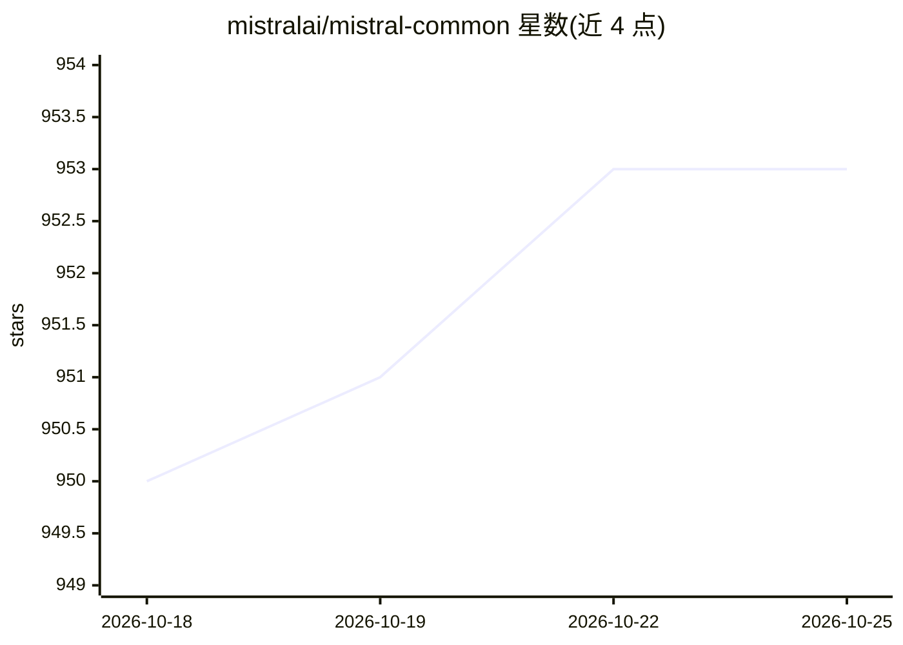

# mistralai/mistral-common

⭐ 954 · Python · Apache-2.0 · 推送 2026-10-24 · [GitHub](https://github.com/mistralai/mistral-common) · 组织维护

**Mistral 模型的分词与请求校验预处理库**

Mistral AI 官方开源的推理预处理库：提供文本、图像与工具调用的分词器，以及基于 Pydantic 的请求、消息、工具调用和响应的校验与规范化代码；分词器按版本管理以保证向后兼容。面向在自有应用中使用 Mistral 模型、或构建模型时复用相同分词与校验代码的开发者。以 pip 安装的 Python 库形式提供，image/audio/hf-hub/sentencepiece/server 等依赖为可选安装，Apache 2.0 许可。

## 筛选速览

| 维度 | 判定 | 备注 |
|---|---|---|
| AI 角色 | `ai-ecosystem` | LLM/agent 周边工具 |
| 许可风险 | `permissive` | Apache-2.0 |
| 部署形态 | `library` | 以包/库形式分发 |
| 模型依赖 | — | README 未给出锁定关系 |
| 硬件要求 | — | 无带数字的原话,不猜 |
| 安装摩擦 | `low` | 无编译、无系统依赖或容器化 |
| 成熟度 | — | 结构信号不足 |

## 能力要点

- 文本、图像与工具调用的分词器
- 基于 Pydantic 的请求/消息/工具调用/响应校验与规范化
- 分词器版本化管理保证向后兼容
- image/audio/hf-hub/sentencepiece/server 可选依赖按需安装

## 适用场景

- 在自有应用中接入 Mistral 模型并复用官方分词与校验逻辑
- 自建模型时使用与 Mistral 相同的分词与校验代码
- 从 Hugging Face Hub 下载并使用 Mistral 分词器

## 场景标签

 · 领域:LLM 基础设施/推理预处理

## 证据(README 行号)

> L13: **mistral-common** is a set of tools to help you work with Mistral AI models.
> L15: We open-source the tokenizers, validation and normalization code that can be used with our models.
> L26: This library is for you if you want to:

## 星数曲线

2026-10-18 950 → 2026-10-25 953（+3）

---
*卡片 v1 · prompt 1.4 · 生成 2026-10-21 · 置信度 high · 依据 README sha `c8313fb20fe3` · [字段定义](../../DATASET.md)*
