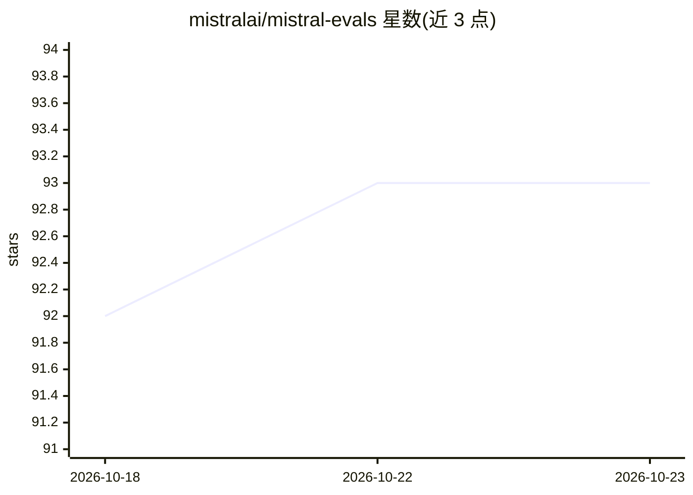

# mistralai/mistral-evals

⭐ 93 · Python · 推送 2025-11-21 · [GitHub](https://github.com/mistralai/mistral-evals) · 组织维护

**Mistral AI 官方评测代码库：跑学术基准与 MM-MT-Bench 评测**

Mistral AI 发布的模型评测工具仓库：提供标准化提示词、解析与指标计算，支持 MM-MT-Bench（GPT-4o 作裁判的多轮 LLM-as-a-judge 任务）及 VQAv2、DocVQA、MathVista、MMMU、ChartQA 等学术基准。典型流程是用 vLLM 托管模型，再运行 eval 脚本对 hosted 模型评测；也可实现自定义 Model 类接入非 vLLM 模型。MM-MT-Bench 需设置 OPENAI_API_KEY 调用 GPT-4o 判分。

## 筛选速览

| 维度 | 判定 | 备注 |
|---|---|---|
| AI 角色 | `ai-ecosystem` | LLM/agent 周边工具 |
| 许可风险 | `none` | — |
| 部署形态 | `library` | 以包/库形式分发 |
| 模型依赖 | local-ok | 支持本地模型 |
| 硬件要求 | — | 无带数字的原话,不猜 |
| 安装摩擦 | `low` | 无编译、无系统依赖或容器化 |
| 成熟度 | — | 结构信号不足 |

## 能力要点

- 支持 MM-MT-Bench（LLM-as-a-judge）及 5 个学术视觉问答/推理基准
- 通过 vLLM 托管模型并以 OpenAI 兼容格式请求评测
- 可自定义 Model 类评测非 vLLM 模型

## 适用场景

- 对多模态模型跑标准化学术基准评测
- 使用 LLM-as-a-judge 做多轮对话质量评测
- 复现 Mistral AI 发布的评测流程

## 场景标签

`模型评测` · 领域:评测与运维

## 证据(README 行号)

> L3: This repository contains code to run evals released by Mistral AI as well as standardized prompts, parsing and metri
> L13: We support the following evals in this repository:

## 星数曲线

2026-10-18 92 → 2026-10-23 93（+1）

---
*卡片 v1 · prompt 1.4 · 生成 2026-10-23 · 置信度 high · 依据 README sha `7449eca94079` · [字段定义](../../DATASET.md)*
