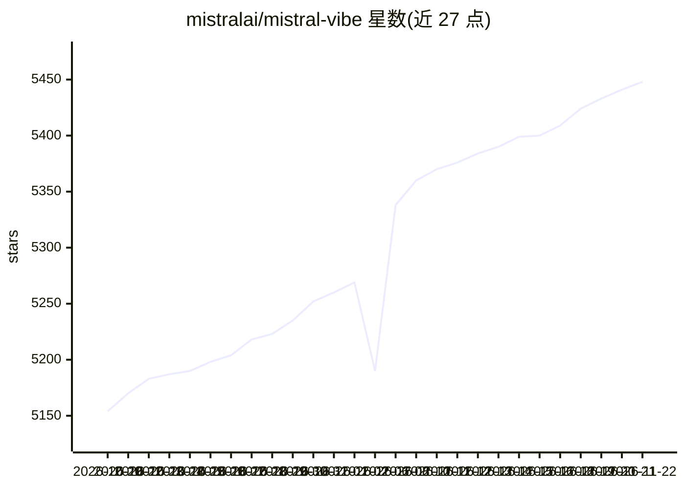

# mistralai/mistral-vibe

⭐ 5,448 · Python · Apache-2.0 · 推送 2026-11-20 · [GitHub](https://github.com/mistralai/mistral-vibe) · 组织维护

**Mistral 出品的终端编码 agent CLI，代读代码改文件跑命令**

Mistral AI 发布的开源终端编码 agent：用户用自然语言描述需求，工具读取代码、编辑文件并执行命令，在执行有风险操作前先请求确认。通过安装脚本或 uv 安装，登录 Mistral 账户或 API key 后运行，提供命令与快捷键、配置、权限审批、IDE 集成与编程模式等文档化能力。默认开启遥测，可在 config.toml 中关闭；仓库不接受 pull request，仅接受 issue 反馈。

## 筛选速览

| 维度 | 判定 | 备注 |
|---|---|---|
| AI 角色 | `ai-ecosystem` | LLM/agent 周边工具 |
| 许可风险 | `permissive` | Apache-2.0 |
| 部署形态 | `library` | 以包/库形式分发 |
| 模型依赖 | — | README 未给出锁定关系 |
| 硬件要求 | — | 无带数字的原话,不猜 |
| 安装摩擦 | `low` | 无编译、无系统依赖或容器化 |
| 成熟度 | — | 结构信号不足 |

## 能力要点

- 终端内读取代码、编辑文件并运行命令，风险操作前需确认
- 支持 Mistral 账户或 API key 登录
- 提供配置、权限审批、IDE 集成与编程模式等能力
- 可通过 config.toml 关闭遥测与崩溃报告

## 适用场景

- 在终端里用自然语言让 agent 修改项目代码
- 对命令执行保留审批确认的工作流
- 在其他 IDE 中接入同一编码 agent

## 场景标签

`编码 Agent` · 领域:编码与开发

## 证据(README 行号)

> L15: Mistral Vibe is an open-source coding agent for your terminal. Describe what you want, and it reads your code, edit
> L36: uv tool install --python 3.14 mistral-vibe

## 星数曲线

2026-10-20 5,154 → 2026-11-22 5,448（+294）

---
*卡片 v1 · prompt 1.4 · 生成 2026-11-22 · 置信度 high · 依据 README sha `1cbba36e2515` · [字段定义](../../DATASET.md)*
