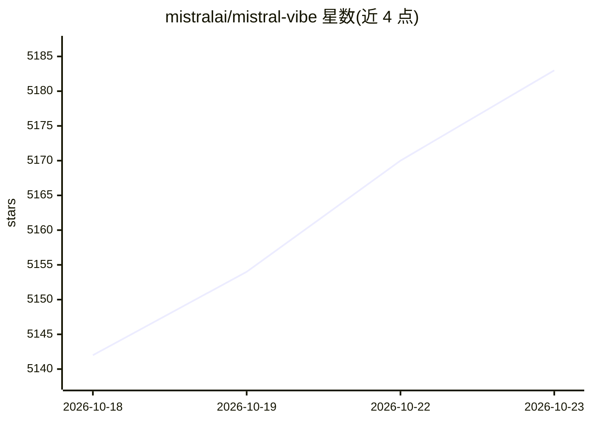

# mistralai/mistral-vibe

⭐ 5,183 · Python · Apache-2.0 · 推送 2026-10-22 · [GitHub](https://github.com/mistralai/mistral-vibe) · 组织维护

**Mistral 官方的命令行 AI 编程助手**

Mistral 开源的命令行编程助手，由 Mistral 模型驱动，提供对话式界面浏览、修改代码库：内置文件读写补丁、shell 命令执行、grep 代码搜索（支持 ripgrep）、todo 跟踪、子代理任务委派等工具；自动提供项目位置、Git 分支与提交历史作为上下文。支持 ask/accept-edits/auto-approve 多种代理配置、config.toml 定制模型与提供商、信任目录机制和工具执行审批。支持交互模式与 --prompt 脚本化运行（含 max-turns/max-price/max-tokens 限额），终端 UI 为捆绑的 Rust 二进制。官方目标为 UNIX 环境，Windows 可运行但非官方支持目标。

## 筛选速览

| 维度 | 判定 | 备注 |
|---|---|---|
| AI 角色 | `ai-native` | 本体是模型或模型工具 |
| 许可风险 | `permissive` | Apache-2.0 |
| 部署形态 | `desktop` | 安装包/桌面程序 |
| 模型依赖 | — | README 未给出锁定关系 |
| 硬件要求 | — | 无带数字的原话,不猜 |
| 安装摩擦 | `low` | 无编译、无系统依赖或容器化 |
| 成熟度 | — | 结构信号不足 |

## 能力要点

- 对话式 agent 工具集：文件读写、shell 执行、grep 搜索（ripgrep）、todo 管理
- 子代理任务委派，独立运行避免上下文过载
- 多代理配置（ask/accept-edits/auto-approve）与工具执行审批
- 程序化模式支持 --max-turns/--max-price/--max-tokens 限额

## 适用场景

- 用自然语言浏览和重构代码库
- 脚本化/CI 中以 --prompt 非交互运行 agent 任务
- 通过子代理并行探索代码结构

## 场景标签

`编码 Agent` · 领域:编码与开发

## 证据(README 行号)

> L15: **Mistral's open-source CLI coding assistant.**
> L17: Mistral Vibe is a command-line coding assistant powered by Mistral's models. It provides a conversational interface

## 星数曲线

2026-10-18 5,142 → 2026-10-23 5,183（+41）

---
*卡片 v1 · prompt 1.4 · 生成 2026-10-20 · 置信度 high · 依据 README sha `c7d36db67f8d` · [字段定义](../../DATASET.md)*
