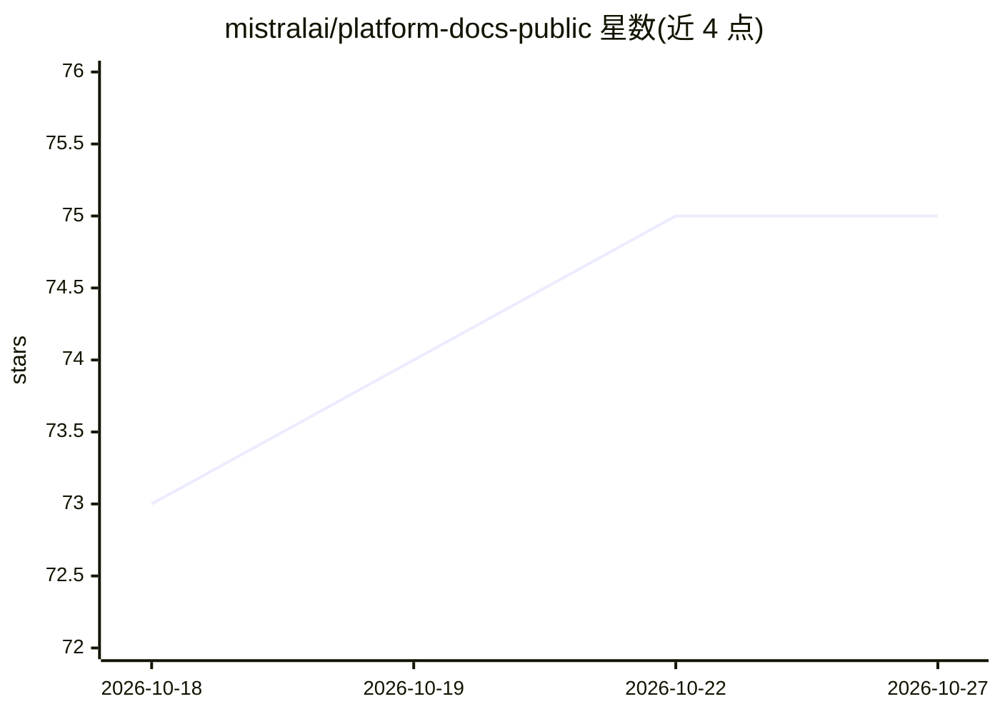

# mistralai/platform-docs-public

⭐ — · [GitHub]() · 组织维护

**Mistral AI 官方 LLM 文档仓库：平台设置与 API 文档**

Mistral AI 维护的公开文档仓库，收录 Mistral LLM 平台设置与 API 的使用文档，基于 Next.js 文档站点构建，支持本地开发服务器与生产构建。文档中可添加 cookbook（通过 cookbooks.config.json 配置 Jupyter notebook 条目），并说明子模块克隆、pnpm 安装等贡献流程。面向使用 Mistral 平台的开发者与文档贡献者。

## 筛选速览

| 维度 | 判定 | 备注 |
|---|---|---|
| AI 角色 | `ai-knowledge` | 知识聚合/清单类 |
| 许可风险 | `permissive` | — |
| 部署形态 | `library` | 以包/库形式分发 |
| 模型依赖 | — | README 未给出锁定关系 |
| 硬件要求 | — | 无带数字的原话,不猜 |
| 安装摩擦 | `low` | 无编译、无系统依赖或容器化 |
| 成熟度 | — | 结构信号不足 |

## 能力要点

- 收录 Mistral LLM 平台设置与 API 文档
- 基于 pnpm/Next.js 的文档站点，支持本地开发与生产构建
- 通过 cookbooks.config.json 向文档添加 notebook 形式的 cookbook

## 适用场景

- 查阅 Mistral LLM API 与平台设置文档
- 为 Mistral 文档提交修改或新增 cookbook
- 本地运行文档站点预览变更

## 场景标签

 · 领域:LLM 平台文档

## 证据(README 行号)

> L1: # Mistral AI LLM documentation
> L3: This folder contains the documentation of the Mistral LLM setup and APIs.

## 星数曲线

2026-10-18 73 → 2026-10-27 75（+2）

---
*卡片 v1 · prompt 1.4 · 生成 2026-10-24 · 置信度 mid · 依据 README sha `31d599da1e28` · [字段定义](../../DATASET.md)*
