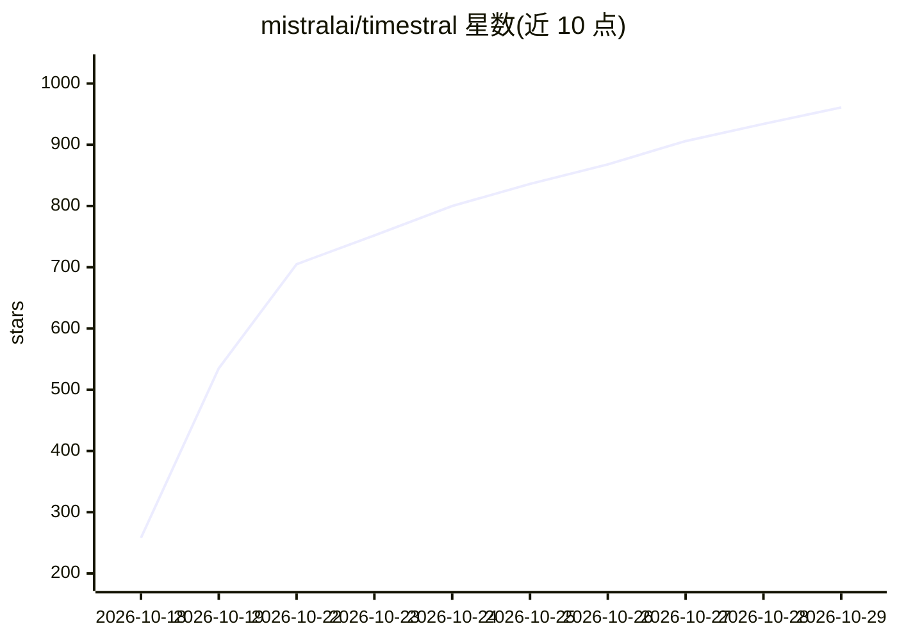

# mistralai/timestral

⭐ 961 · Python · Apache-2.0 · 推送 2026-10-15 · [GitHub](https://github.com/mistralai/timestral) · 组织维护

**面向开发者的多变量概率时序预测基础模型及推理库**

Mistral AI 发布的时序基础模型家族 Timestral 的官方推理仓库，提供 5M/28M/123M/209M 四种规模权重（在 Hugging Face Hub 单独发布），支持多变量联合预测、past-only/known-future/类别协变量、每步 21 个分位数的概率输出与最长 32,768 步上下文。推理仅需 PyTorch/NumPy/safetensors/huggingface_hub，CPU 或 GPU 均可运行。代码 Apache 2.0，模型权重为 Modified MIT。限制：仓库仅含推理，不提供训练。

## 筛选速览

| 维度 | 判定 | 备注 |
|---|---|---|
| AI 角色 | `ai-native` | 本体是模型或模型工具 |
| 许可风险 | `permissive` | Apache-2.0 |
| 部署形态 | `library` | 以包/库形式分发 |
| 模型依赖 | — | README 未给出锁定关系 |
| 硬件要求 | `cpu-ok` | |
| 安装摩擦 | `low` | 无编译、无系统依赖或容器化 |
| 成熟度 | — | 结构信号不足 |

## 能力要点

- 多变量概率预测，每步输出 21 个分位数
- 支持 past-only、known-future 与类别协变量（类别经 target encoding）
- 上下文最长 32,768 步，CPU 即可推理
- causal patch-based transformer，Decoupled Horizon Forecasting 训练

## 适用场景

- 多变量业务时序（如需求、负载）的概率预测
- 零样本时序预测，无需针对每个任务重新训练
- 在 CPU 环境部署轻量级时序预测模型（最小 21MB 权重）

## 场景标签

`推理引擎` · 领域:训练与推理

## 证据(README 行号)

> L9: Timestral is a family of time series foundation models for multivariate probabilistic forecasting, with support for 
> L10: This repository provides standalone inference for Timestral models. It needs only PyTorch, NumPy, `safetensors` and

## 星数曲线

2026-10-18 258 → 2026-10-29 961（+703）

---
*卡片 v1 · prompt 1.4 · 生成 2026-10-21 · 置信度 mid · 依据 README sha `a14869a879d1` · [字段定义](../../DATASET.md)*
