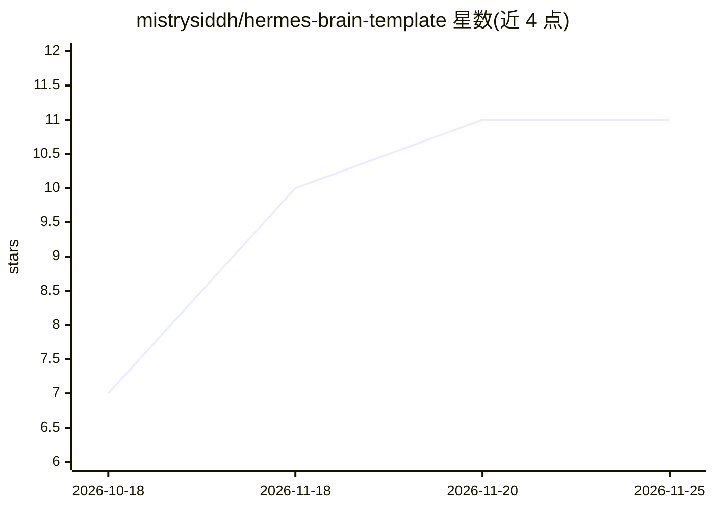

# mistrysiddh/hermes-brain-template

⭐ 11 · Python · MIT · 推送 2026-11-23 · [GitHub](https://github.com/mistrysiddh/hermes-brain-template) · [官网](https://hermes-second-brain.mistrysiddh.in/) · 个人维护

**给 Hermes/OpenClaw agent 配套的 Obsidian 记忆库模板**

一个 Obsidian vault 模板，为 Hermes/OpenClaw agent 提供会话存档与记忆审核流水线：每次 agent 会话以纯 markdown 自动归档、去重并清除敏感信息，候选记忆先进入 Memory-Review 看板，经人工批准后才写入 Hermes 原生 MEMORY.md/USER.md。库结构按 PARA 方法组织，附带 MCP server（连接 Hermes/Obsidian 与 LLM）、跨平台安装/归档/审计等 Python 脚本、Dataview 查询、Kanban 看板与 Canvas 流程图。提供一键安装脚本、GitHub 模板克隆、向 agent 粘贴提示词、临时试运行及 Codespaces 多种安装途径。

## 筛选速览

| 维度 | 判定 | 备注 |
|---|---|---|
| AI 角色 | `ai-ecosystem` | LLM/agent 周边工具 |
| 许可风险 | `permissive` | MIT |
| 部署形态 | `None` |  |
| 模型依赖 | local-ok | 支持本地模型 |
| 硬件要求 | — | 无带数字的原话,不猜 |
| 安装摩擦 | `low` | 无编译、无系统依赖或容器化 |
| 成熟度 | — | 结构信号不足 |

## 能力要点

- 会话自动归档为纯 markdown，人工审核后才晋升为持久记忆
- MCP server 将 Hermes Agent/Obsidian 接入 LLM，附自测套件
- PARA 结构 vault，预配置 Dataview/Smart Connections/Local REST API/Kanban 插件
- 跨平台（Windows/Linux/macOS）安装与运维脚本，默认 --dry-run 且仅用标准库

## 适用场景

- 查看并批准 agent 记住了什么，避免黑箱式自动记忆
- 长期保存并检索 agent 会话记录与 token 用量
- 在 Obsidian 中以看板方式分拣待审核的记忆条目

## 场景标签

`知识库管理` `Agent 记忆` · 领域:Agent 开发

## 证据(README 行号)

> L8: **Give your Hermes/OpenClaw agent a memory it can't forget — and you can actually read.**
> L62: |🔌 **AI agents can't access your knowledge**|MCP server connects Hermes Agent/Obsidian to LLMs|`python _System/Scri
> L71: 04-Archives/Daily/YYYY/MM/DD/*.md   →   04-Archives/Memory-Review/*.md   →   Hermes native MEMORY.md / USER.md

## 星数曲线

2026-10-18 7 → 2026-11-25 11（+4）

---
*卡片 v1 · prompt 1.4 · 生成 2026-11-19 · 置信度 high · 依据 README sha `415a9d5d21c5` · [字段定义](../../DATASET.md)*
